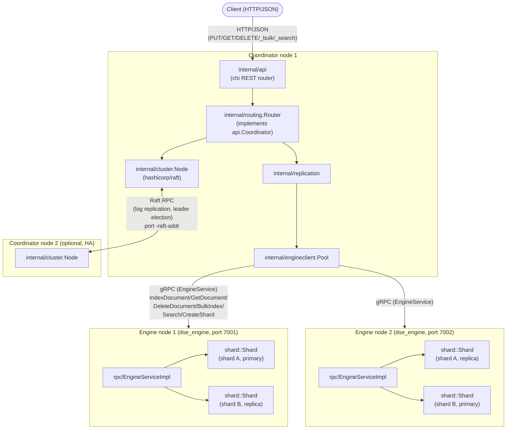

# dse — Codebase Reference (every file, every function)

This document is a **file-by-file, function-by-function API reference** for
the `dse` distributed search engine. It complements, and does not replace,
[`../DOCUMENTATION.md`](../DOCUMENTATION.md), which is the narrative
architectural blueprint (design rationale, execution-flow prose walkthroughs,
on-disk formats, consistency model, and an honest list of simplifications).
Read `DOCUMENTATION.md` first for the "why"; use this document as the
ground-truth reference for exact signatures, exact algorithms, and exact
constants when you need to modify or extend the code.

Every signature and code excerpt below was copied verbatim from the current
source tree (coordinator: 2,530 lines of Go; engine: 5,863 lines of C++,
excluding generated protobuf code, vendored `third_party/json.hpp`, and
build artifacts). Line counts cited per file are current at time of writing.

---

## Table of contents

1. [System overview](#1-system-overview)
2. [The gRPC contract (`proto/engine.proto`)](#2-the-grpc-contract-protoengineproto)
3. [Coordinator (Go) — package reference](#3-coordinator-go--package-reference)
   - 3.1 [`cmd/coordinator`](#31-cmdcoordinatormaingo)
   - 3.2 [`internal/api`](#32-internalapi)
   - 3.3 [`internal/cluster`](#33-internalcluster)
   - 3.4 [`internal/config`](#34-internalconfig)
   - 3.5 [`internal/engineclient`](#35-internalengineclient)
   - 3.6 [`internal/replication`](#36-internalreplication)
   - 3.7 [`internal/routing`](#37-internalrouting)
   - 3.8 [`internal/genproto`](#38-internalgenproto-generated)
4. [Engine (C++) — module reference](#4-engine-c--module-reference)
   - 4.1 [`analysis/`](#41-analysis-tokenizer--analyzer)
   - 4.2 [`bitmap/`](#42-bitmap-roaringbitmap)
   - 4.3 [`document/`](#43-document-document)
   - 4.4 [`index/`](#44-index-invertedindex)
   - 4.5 [`segment/`](#45-segment-segment--segmentmerger)
   - 4.6 [`scoring/`](#46-scoring-bm25scorer)
   - 4.7 [`vector/`](#47-vector-hnswindex)
   - 4.8 [`aggregation/`](#48-aggregation-aggregator)
   - 4.9 [`shard/`](#49-shard-shard)
   - 4.10 [`storage/`](#410-storage-mmapfile)
   - 4.11 [`wal/`](#411-wal-writeaheadlog)
   - 4.12 [`rpc/`](#412-rpc-engineserviceimpl)
   - 4.13 [`main.cpp`](#413-maincpp)
5. [Data flow walkthroughs](#5-data-flow-walkthroughs)
6. [Build & deployment](#6-build--deployment)
7. [Testing](#7-testing)
8. [Cross-file constants summary](#8-cross-file-constants-summary)

---

## 1. System overview

`dse` is a hybrid two-language distributed search engine:

- **Coordinator (Go, `coordinator/`, 2,530 lines excluding generated code)**
  — stateless-except-for-Raft REST API front door. Owns cluster membership
  and shard-placement metadata via a `hashicorp/raft` consensus group,
  performs FNV-1a hash-based document routing, and executes scatter-gather
  search across engine nodes.
- **Engine (C++, `engine/`, 5,863 lines excluding generated code / vendored
  json.hpp / build artifacts)** — the actual storage and execution core. One
  process per data node; owns zero or more **shards**, each with its own
  inverted index, HNSW vector index, WAL, and set of immutable on-disk
  segments.
- **The contract**: `proto/engine.proto` — a gRPC service (`EngineService`)
  with 10 RPCs, generated into `coordinator/internal/genproto/*.pb.go` (Go)
  and `engine/genproto/engine.{pb,grpc.pb}.{h,cc}` (C++). This is the *only*
  thing the two languages agree on.

### 1.1 Component / communication diagram



- **Coordinator ↔ Coordinator**: Raft consensus (TCP transport at
  `-raft-addr`) replicates one small FSM (`cluster.State`: which indices
  exist, their field mappings, and each shard's primary/replica placement).
  A non-Raft `POST /_cluster/join` REST endpoint bootstraps membership
  changes (see §5.3).
- **Coordinator ↔ Engine**: gRPC, one long-lived `grpc.ClientConn` per
  engine-node address cached in `engineclient.Pool`, insecure transport (no
  TLS — see `DOCUMENTATION.md` §16). Ten RPCs are defined; the coordinator
  codebase itself only calls `IndexDocument`, `GetDocument`,
  `DeleteDocument`, `BulkIndex`, `Search`, and `CreateShard` — `Flush`,
  `Merge`, `ShardStatus`, `Health` exist in the contract but are invoked
  only internally by the engine's own background maintenance thread and by
  C++ tests, not reachable from the Go side today.
- **Engine internals**: `rpc::EngineServiceImpl` is a thin gRPC↔`Shard`
  translation layer holding a `shard_id -> unique_ptr<Shard>` map; each
  `Shard` owns one WAL, one mutable memtable `InvertedIndex`, N immutable
  `Segment`s, one tombstone `RoaringBitmap`, and one `HNSWIndex` per
  vector-typed field.

---

## 2. The gRPC contract (`proto/engine.proto`)

253 lines, `syntax = "proto3"`, `package dse`, Go package
`dse/coordinator/internal/genproto;genproto`.

### 2.1 Service definition (verbatim)

```protobuf
service EngineService {
  // Document CRUD
  rpc IndexDocument(IndexRequest) returns (IndexResponse);
  rpc GetDocument(GetRequest) returns (GetResponse);
  rpc DeleteDocument(DeleteRequest) returns (DeleteResponse);
  rpc BulkIndex(BulkRequest) returns (BulkResponse);

  // Search (this is the target of scatter-gather fan-out)
  rpc Search(SearchRequest) returns (SearchResponse);

  // Shard / segment administration
  rpc CreateShard(CreateShardRequest) returns (CreateShardResponse);
  rpc Flush(FlushRequest) returns (FlushResponse);
  rpc Merge(MergeRequest) returns (MergeResponse);
  rpc ShardStatus(ShardStatusRequest) returns (ShardStatusResponse);
  rpc Health(HealthRequest) returns (HealthResponse);
}
```

### 2.2 Message reference

| Message | Fields |
|---|---|
| `Document` | `id:string`, `json:string` (raw body), `version:int64` (engine-assigned) |
| `IndexRequest` | `shard_id:string`, `document:Document` |
| `IndexResponse` | `success:bool`, `error:string`, `version:int64` |
| `GetRequest` / `DeleteRequest` | `shard_id:string`, `doc_id:string` |
| `GetResponse` | `found:bool`, `document:Document` |
| `DeleteResponse` | `success:bool`, `found:bool` |
| `BulkOp` | `type:Type{INDEX=0,DELETE=1}`, `doc_id:string`, `json:string` |
| `BulkRequest` | `shard_id:string`, `ops:repeated BulkOp` |
| `BulkResult` | `success:bool`, `error:string`, `doc_id:string` |
| `BulkResponse` | `results:repeated BulkResult` |
| `TermFilter` | `field:string`, `value:string` |
| `RangeFilter` | `field:string`, `gte:optional double`, `lte:optional double` |
| `Filter` | `term:repeated TermFilter`, `range:repeated RangeFilter` |
| `VectorQuery` | `field:string`, `embedding:repeated float`, `k:int32` |
| `Aggregation` | `name:string`, `type:string("terms"\|"stats"\|"histogram")`, `field:string`, `size:int32`, `interval:double` |
| `SearchRequest` | `shard_id`, `query_text`, `fields:repeated string`, `filter:Filter`, `vector:VectorQuery`, `vector_weight:double`, `aggregations:repeated Aggregation`, `size:int32`, `from:int32` |
| `SearchHit` | `doc_id:string`, `score:double`, `json:string` |
| `Bucket` | `key:string`, `doc_count:int64` |
| `StatsResult` | `count:int64`, `sum/min/max/avg:double` |
| `AggregationResult` | `name:string`, `buckets:repeated Bucket`, `stats:StatsResult` |
| `SearchResponse` | `success:bool`, `error:string`, `hits:repeated SearchHit`, `total_hits:int64`, `aggregations:repeated AggregationResult`, `took_micros:int64` |
| `FieldMapping` | `field:string`, `type:string("text"\|"keyword"\|"number"\|"vector")`, `vector_dim:int32` |
| `CreateShardRequest`/`Response` | `shard_id`, `mappings:repeated FieldMapping` / `success`, `error` |
| `FlushRequest`/`Response` | `shard_id` / `success`, `error`, `segment_id:int32` |
| `MergeRequest`/`Response` | `shard_id` / `success`, `error`, `segments_merged:int32`, `result_segment_id:int32` |
| `ShardStatusRequest`/`Response` | `shard_id` / `exists:bool`, `doc_count`, `deleted_count`, `segment_count`, `wal_size_bytes`, `memtable_doc_count` |
| `HealthRequest`/`Response` | `{}` / `healthy:bool`, `node_id:string`, `shard_ids:repeated string`, `uptime_seconds:int64` |

### 2.3 Design choices (from proto header comments)

- **A "shard" is the unit of storage on an engine node**: one inverted index
  + one HNSW vector index + one WAL + one on-disk segment set.
- **Documents are raw JSON strings**, not typed protobuf messages, because
  the schema is user-defined (schemaless); the engine parses/analyzes
  fields per the shard's field mapping set once at `CreateShard` time.
- **Filters/vector queries/aggregations are explicit typed messages**, not
  a generic query-DSL blob — keeps the C++ query planner in `Shard::Search`
  simple and the scatter-gather contract explicit/versioned.

### 2.4 Regenerating stubs

```bash
# Go
protoc --go_out=coordinator --go_opt=module=dse/coordinator \
       --go-grpc_out=coordinator --go-grpc_opt=module=dse/coordinator \
       -I proto proto/engine.proto
# C++
protoc -I proto --cpp_out=engine/genproto --grpc_out=engine/genproto \
       --plugin=protoc-gen-grpc=$(brew --prefix grpc)/bin/grpc_cpp_plugin \
       proto/engine.proto
```

### 2.5 Generated `EngineServiceClient` (Go) — RPC method set

`coordinator/internal/genproto/engine_grpc.pb.go` (484 lines, generated):

```go
type EngineServiceClient interface {
	IndexDocument(ctx context.Context, in *IndexRequest, opts ...grpc.CallOption) (*IndexResponse, error)
	GetDocument(ctx context.Context, in *GetRequest, opts ...grpc.CallOption) (*GetResponse, error)
	DeleteDocument(ctx context.Context, in *DeleteRequest, opts ...grpc.CallOption) (*DeleteResponse, error)
	BulkIndex(ctx context.Context, in *BulkRequest, opts ...grpc.CallOption) (*BulkResponse, error)
	Search(ctx context.Context, in *SearchRequest, opts ...grpc.CallOption) (*SearchResponse, error)
	CreateShard(ctx context.Context, in *CreateShardRequest, opts ...grpc.CallOption) (*CreateShardResponse, error)
	Flush(ctx context.Context, in *FlushRequest, opts ...grpc.CallOption) (*FlushResponse, error)
	Merge(ctx context.Context, in *MergeRequest, opts ...grpc.CallOption) (*MergeResponse, error)
	ShardStatus(ctx context.Context, in *ShardStatusRequest, opts ...grpc.CallOption) (*ShardStatusResponse, error)
	Health(ctx context.Context, in *HealthRequest, opts ...grpc.CallOption) (*HealthResponse, error)
}
```

`coordinator/internal/genproto/engine.pb.go` (2,310 lines, generated) holds
every message type listed in §2.2 as a Go struct with standard
`proto.Message` plumbing — not enumerated field-by-field here since it's a
1:1 mechanical mirror of §2.2.

---

## 3. Coordinator (Go) — package reference

Layering, innermost to outermost: `internal/cluster` (Raft FSM) →
`internal/config` (CLI flags) → `internal/engineclient` (gRPC pool) →
`internal/genproto` (generated) → `internal/replication` (write fan-out) →
`internal/routing` (scatter-gather, implements `api.Coordinator`) →
`internal/api` (REST/HTTP) → `cmd/coordinator/main.go` (wiring).

### 3.1 `cmd/coordinator/main.go`

151 lines.

```go
type joinRequest struct {
	NodeID   string `json:"node_id"`
	RaftAddr string `json:"raft_addr"`
}

func main()
func registerInitialEngineNodes(node *cluster.Node, addrs []string)
func requestJoin(joinAddr, nodeID, raftAddr string)
```

Wires up `cluster.Node` (Raft), `engineclient.Pool`, `routing.Router`
(implements `api.Coordinator`), and the `api.NewRouter`-built `chi.Mux`,
then registers two extra routes not part of the `api` package's
Coordinator-driven set:

- `POST /_cluster/join` — inline closure delegating to `node.Join` (Raft
  membership admission).
- `GET /health` — inline closure returning `{"status":"ok"}` (liveness).

If `cfg.Bootstrap`, spawns `registerInitialEngineNodes` in a goroutine:
polls up to 10s (every 100ms) for this node to become Raft leader, then
commits one `CmdRegisterEngineNode` Raft command per `-engine-nodes`
address. If `cfg.JoinAddr` is set, spawns `requestJoin` (after a 500ms
delay to let the Raft transport start) to `POST` a join request against an
existing cluster member's `/_cluster/join`.

### 3.2 `internal/api`

Package doc: "defines the JSON wire types and the `Coordinator` interface
the HTTP handlers depend on; the actual search/indexing logic is
implemented elsewhere (see the `routing` package) against this contract."

#### 3.2.1 `types.go` (136 lines) — every JSON wire type

```go
type BulkOp struct {
	Type  string          `json:"type"` // "index" | "delete"
	DocID string          `json:"doc_id,omitempty"`
	Body  json.RawMessage `json:"body,omitempty"` // required for "index"
}

type BulkOpResult struct {
	Success bool   `json:"success"`
	Error   string `json:"error,omitempty"`
	DocID   string `json:"doc_id"`
}

type FieldMapping struct {
	Field     string `json:"field"`
	Type      string `json:"type"` // "text" | "keyword" | "number" | "vector"
	VectorDim int    `json:"vector_dim,omitempty"`
}

type CreateIndexRequest struct {
	Mappings []FieldMapping `json:"mappings"`
	Shards   int            `json:"shards,omitempty"`
	Replicas int            `json:"replicas,omitempty"`
}

type TermFilter struct {
	Field string `json:"field"`
	Value string `json:"value"`
}

type RangeFilter struct {
	Field string   `json:"field"`
	Gte   *float64 `json:"gte,omitempty"`
	Lte   *float64 `json:"lte,omitempty"`
}

type Filter struct {
	Term  []TermFilter  `json:"term,omitempty"`
	Range []RangeFilter `json:"range,omitempty"`
}

type VectorQuery struct {
	Field     string    `json:"field"`
	Embedding []float32 `json:"embedding"`
	K         int       `json:"k"`
}

type Aggregation struct {
	Name     string  `json:"name"`
	Type     string  `json:"type"` // "terms" | "stats" | "histogram"
	Field    string  `json:"field"`
	Size     int     `json:"size,omitempty"`
	Interval float64 `json:"interval,omitempty"`
}

type SearchRequest struct {
	Query        string        `json:"query,omitempty"`
	Fields       []string      `json:"fields,omitempty"`
	Filter       *Filter       `json:"filter,omitempty"`
	Vector       *VectorQuery  `json:"vector,omitempty"`
	VectorWeight float64       `json:"vector_weight,omitempty"`
	Aggregations []Aggregation `json:"aggregations,omitempty"`
	Size         int           `json:"size,omitempty"`
	From         int           `json:"from,omitempty"`
}

type SearchHit struct {
	DocID  string          `json:"doc_id"`
	Score  float64         `json:"score"`
	Source json.RawMessage `json:"source"`
}

type Bucket struct {
	Key      string `json:"key"`
	DocCount int64  `json:"doc_count"`
}

type StatsResult struct {
	Count int64   `json:"count"`
	Sum   float64 `json:"sum"`
	Min   float64 `json:"min"`
	Max   float64 `json:"max"`
	Avg   float64 `json:"avg"`
}

type AggregationResult struct {
	Name    string       `json:"name"`
	Buckets []Bucket     `json:"buckets,omitempty"`
	Stats   *StatsResult `json:"stats,omitempty"`
}

type SearchResponse struct {
	Hits         []SearchHit         `json:"hits"`
	TotalHits    int64               `json:"total_hits"`
	Aggregations []AggregationResult `json:"aggregations,omitempty"`
	TookMillis   int64               `json:"took_millis"`
}

type ShardInfo struct {
	ShardID  string   `json:"shard_id"`
	Index    string   `json:"index"`
	Primary  string   `json:"primary"`
	Replicas []string `json:"replicas"`
}

type ClusterStatusResponse struct {
	NodeID   string      `json:"node_id"`
	IsLeader bool        `json:"is_leader"`
	Leader   string      `json:"leader"`
	Nodes    []string    `json:"nodes"`
	Shards   []ShardInfo `json:"shards"`
}
```

#### 3.2.2 `router.go` (80 lines)

```go
var ErrIndexNotFound = errors.New("api: index not found")

// Coordinator is implemented by internal/routing.Router — the sole
// dependency of the HTTP layer. All methods receive the request-scoped
// context.Context from the incoming *http.Request.
type Coordinator interface {
	CreateIndex(ctx context.Context, index string, req CreateIndexRequest) error
	IndexDocument(ctx context.Context, index, docID string, body json.RawMessage) (version int64, err error)
	GetDocument(ctx context.Context, index, docID string) (body json.RawMessage, found bool, err error)
	DeleteDocument(ctx context.Context, index, docID string) (found bool, err error)
	BulkIndex(ctx context.Context, index string, ops []BulkOp) ([]BulkOpResult, error)
	Search(ctx context.Context, index string, req SearchRequest) (SearchResponse, error)
	ClusterStatus(ctx context.Context) (ClusterStatusResponse, error)
}

type handlers struct{ coord Coordinator }
type errorResponse struct{ Error string `json:"error"` }

func NewRouter(coord Coordinator) *chi.Mux
func writeJSON(w http.ResponseWriter, status int, body any)
func writeError(w http.ResponseWriter, status int, msg string)
func pathParam(r *http.Request, name string) (string, bool)
```

`NewRouter` builds the `chi.Mux`, installs `middleware.Recoverer`,
constructs `handlers{coord}`, and registers the six data-plane routes plus
`/_cluster/health`.

**Full REST route table** (six routes registered in `router.go`, two more
attached directly in `main.go`):

| Method | Path | Handler |
|---|---|---|
| PUT | `/indices/{index}` | `h.createIndex` |
| PUT | `/indices/{index}/_doc/{id}` | `h.indexDocument` |
| GET | `/indices/{index}/_doc/{id}` | `h.getDocument` |
| DELETE | `/indices/{index}/_doc/{id}` | `h.deleteDocument` |
| POST | `/indices/{index}/_bulk` | `h.bulkIndex` |
| POST | `/indices/{index}/_search` | `h.search` |
| GET | `/_cluster/health` | `h.clusterHealth` |
| POST | `/_cluster/join` | inline closure in `main.go` |
| GET | `/health` | inline closure in `main.go` |

#### 3.2.3 `cluster.go` (14 lines)

```go
func (h *handlers) clusterHealth(w http.ResponseWriter, r *http.Request)
```

Calls `h.coord.ClusterStatus(r.Context())`, writes 200 JSON or 500 on error.

#### 3.2.4 `documents.go` (205 lines)

```go
type bulkRequest struct{ Ops []BulkOp `json:"ops"` }
type bulkResponse struct{ Results []BulkOpResult `json:"results"` }

func (h *handlers) createIndex(w http.ResponseWriter, r *http.Request)
func (h *handlers) indexDocument(w http.ResponseWriter, r *http.Request)
func (h *handlers) getDocument(w http.ResponseWriter, r *http.Request)
func (h *handlers) deleteDocument(w http.ResponseWriter, r *http.Request)
func (h *handlers) bulkIndex(w http.ResponseWriter, r *http.Request)
func decodeJSON(r *http.Request, v any) error
```

- `createIndex`: decodes `CreateIndexRequest`, calls `CreateIndex`, 201
  `{"acknowledged": true}`.
- `indexDocument`: reads raw body, validates via `json.Valid`, calls
  `IndexDocument`; always 201 (create vs. update is transparent); maps
  `ErrIndexNotFound` → 404.
- `getDocument`: 200 with `found`/`source`, or 404 when not found or on
  `ErrIndexNotFound`.
- `deleteDocument`: 200 `{found:true}` or 404 `{found:false}`.
- `bulkIndex`: decodes `bulkRequest`, delegates to `BulkIndex`, always 200
  with per-op results — individual op failures don't fail the HTTP call.
- `decodeJSON`: nil/empty body is a no-op (leaves `v` zero-valued);
  otherwise unmarshals with descriptive error wrapping.

#### 3.2.5 `search.go` (36 lines)

```go
const defaultSearchSize = 10

func (h *handlers) search(w http.ResponseWriter, r *http.Request)
```

Empty/missing body is valid (zero-value `SearchRequest` == match-all). If
`req.Size <= 0`, defaults to 10. Delegates to `Search`, 200 or 500.

### 3.3 `internal/cluster`

#### 3.3.1 `fsm.go` (209 lines) — the Raft FSM

```go
type CommandType string

const (
	CmdCreateIndex        CommandType = "create_index"
	CmdRegisterEngineNode CommandType = "register_engine_node"
)

type Command struct {
	Type               CommandType            `json:"type"`
	CreateIndex        *CreateIndexCommand    `json:"create_index,omitempty"`
	RegisterEngineNode *RegisterEngineNodeCmd `json:"register_engine_node,omitempty"`
}

// CreateIndexCommand captures the engine-node pool AT COMMAND-BUILD TIME
// (by the Raft leader, in routing.Router.CreateIndex) — NOT read fresh from
// local state at apply time — so every coordinator replaying this log entry
// computes the identical shard placement (a Raft replicated-state-machine
// requirement).
type CreateIndexCommand struct {
	Name        string         `json:"name"`
	Mappings    []FieldMapping `json:"mappings"`
	NumShards   int            `json:"num_shards"`
	NumReplicas int            `json:"num_replicas"`
	EngineNodes []string       `json:"engine_nodes"`
}

type RegisterEngineNodeCmd struct{ Addr string `json:"addr"` }

type ApplyResult struct {
	Error string      `json:"error,omitempty"`
	Value interface{} `json:"value,omitempty"`
}

type FSM struct {
	mu    sync.RWMutex
	state *State
}
type fsmSnapshot struct{ state *State }

func NewFSM() *FSM
func (f *FSM) State() *State
func (f *FSM) Apply(entry *raft.Log) interface{}
func (f *FSM) applyCreateIndex(cmd *CreateIndexCommand) ApplyResult
func (f *FSM) applyRegisterEngineNode(cmd *RegisterEngineNodeCmd) ApplyResult
func (f *FSM) Snapshot() (raft.FSMSnapshot, error)
func (s *fsmSnapshot) Persist(sink raft.SnapshotSink) error
func (s *fsmSnapshot) Release()
func (f *FSM) Restore(rc io.ReadCloser) error
```

**`Apply`** — JSON-unmarshals the log entry into `Command`, locks `f.mu`,
dispatches on `cmd.Type`:

```go
func (f *FSM) Apply(entry *raft.Log) interface{} {
	var cmd Command
	if err := json.Unmarshal(entry.Data, &cmd); err != nil {
		return ApplyResult{Error: fmt.Sprintf("malformed command: %v", err)}
	}
	f.mu.Lock()
	defer f.mu.Unlock()
	switch cmd.Type {
	case CmdCreateIndex:
		return f.applyCreateIndex(cmd.CreateIndex)
	case CmdRegisterEngineNode:
		return f.applyRegisterEngineNode(cmd.RegisterEngineNode)
	default:
		return ApplyResult{Error: fmt.Sprintf("unknown command type: %s", cmd.Type)}
	}
}
```

**Shard-placement algorithm** — the exact primary/replica formula, verbatim
from `applyCreateIndex`:

```go
func (f *FSM) applyCreateIndex(cmd *CreateIndexCommand) ApplyResult {
	if cmd == nil { return ApplyResult{Error: "create_index command missing payload"} }
	if _, exists := f.state.Indices[cmd.Name]; exists {
		return ApplyResult{Error: fmt.Sprintf("index %q already exists", cmd.Name)}
	}
	if len(cmd.EngineNodes) == 0 {
		return ApplyResult{Error: "no engine nodes available to place shards on"}
	}
	numShards := cmd.NumShards
	if numShards <= 0 { numShards = 1 }
	numReplicas := cmd.NumReplicas
	if numReplicas < 0 { numReplicas = 0 }
	maxReplicas := len(cmd.EngineNodes) - 1
	if maxReplicas < 0 { maxReplicas = 0 }
	if numReplicas > maxReplicas { numReplicas = maxReplicas }

	shards := make([]ShardMeta, 0, numShards)
	for i := 0; i < numShards; i++ {
		primary := cmd.EngineNodes[i%len(cmd.EngineNodes)]
		var replicas []string
		for j := 0; j < numReplicas; j++ {
			candidate := cmd.EngineNodes[(i+j+1)%len(cmd.EngineNodes)]
			if candidate == primary || containsString(replicas, candidate) { continue }
			replicas = append(replicas, candidate)
		}
		shards = append(shards, ShardMeta{
			ShardID: fmt.Sprintf("%s-shard-%d", cmd.Name, i),
			Index: cmd.Name, Primary: primary, Replicas: replicas,
		})
	}
	f.state.Indices[cmd.Name] = &IndexMeta{
		Name: cmd.Name, Mappings: append([]FieldMapping(nil), cmd.Mappings...), Shards: shards,
	}
	return ApplyResult{Value: f.state.Indices[cmd.Name]}
}
```

In words: shard `i`'s **primary** is `EngineNodes[i % N]` (round-robin).
Each of `numReplicas` replica slots `j` (0-indexed) walks forward around the
node ring starting one position after the primary —
`EngineNodes[(i+j+1) % N]` — skipped if it equals the primary or is already
chosen. `numReplicas` is clamped to at most `len(EngineNodes)-1`.

`applyRegisterEngineNode` idempotently appends an address to
`state.EngineNodes` if not already present (`containsString`).

**Snapshot/Restore** (verbatim): `Snapshot()` read-locks, deep-clones state
(`state.clone()`) into a `fsmSnapshot`; `Persist` JSON-marshals it to the
`raft.SnapshotSink`; `Restore` JSON-decodes a full `State` and swaps it in
wholesale under the write lock, guarding a nil `Indices` map.

#### 3.3.2 `node.go` (160 lines)

```go
type Node struct {
	NodeID string
	Raft   *raft.Raft
	FSM    *FSM
}

type Config struct {
	NodeID    string
	RaftAddr  string // host:port, dialable by other nodes
	RaftDir   string
	Bootstrap bool
}

func NewNode(cfg Config) (*Node, error)
func (n *Node) IsLeader() bool
func (n *Node) LeaderAddr() string
func (n *Node) Apply(cmd Command, timeout time.Duration) (ApplyResult, error)
func (n *Node) Join(nodeID, raftAddr string) error
func (n *Node) Peers() ([]string, error)
```

`NewNode` builds `raft.Raft` on a BoltDB log/stable store
(`raftboltdb.New`) and a file snapshot store (`raft.NewFileSnapshotStore`),
rooted at `cfg.RaftDir`, transport via `raft.NewTCPTransport`. If
`cfg.Bootstrap` and no existing state (`raft.HasExistingState`), calls
`BootstrapCluster` with itself as the sole voter — safe to restart a
bootstrap node without re-bootstrapping. `IsLeader` checks
`n.Raft.State() == raft.Leader` (documented as possibly stale — no
linearizable-read guarantee). `Join` (leader-only) calls `n.Raft.AddVoter`.
`Apply` JSON-marshals a `Command`, calls `n.Raft.Apply`, blocks, type-asserts
`ApplyResult`. `Peers` reads `n.Raft.GetConfiguration()`.

#### 3.3.3 `state.go` (81 lines)

```go
type FieldMapping struct {
	Field     string `json:"field"`
	Type      string `json:"type"`
	VectorDim int    `json:"vector_dim,omitempty"`
}

type ShardMeta struct {
	ShardID  string   `json:"shard_id"`
	Index    string   `json:"index"`
	Primary  string   `json:"primary"`
	Replicas []string `json:"replicas"`
}

type IndexMeta struct {
	Name     string         `json:"name"`
	Mappings []FieldMapping `json:"mappings"`
	Shards   []ShardMeta    `json:"shards"`
}

type State struct {
	Indices     map[string]*IndexMeta `json:"indices"`
	EngineNodes []string              `json:"engine_nodes"`
}

func newEmptyState() *State
func (s *State) clone() *State
func containsString(haystack []string, needle string) bool
```

`clone()` does a full deep copy (new maps/slices at every level) so
`FSM.State()` callers get an independently-mutable snapshot.

### 3.4 `internal/config`

`config.go` (146 lines):

```go
type NodeConfig struct {
	NodeID            string
	HTTPAddr          string
	RaftAddr          string
	RaftDir           string
	Bootstrap         bool
	JoinAddr          string
	EngineNodes       []string
	NumShards         int
	ReplicationFactor int
}

func Load() NodeConfig
func parseEngineNodes(raw string) []string
```

`Load()` uses a **fresh `flag.NewFlagSet` per call** (never the global
`flag.CommandLine`), so it's safe to call more than once per process (the
test suite relies on this). Flags: `-node-id` (default
`"node-" + uuid.NewString()[:8]`), `-http-addr` (`:8080`), `-raft-addr`
(`127.0.0.1:9000`), `-raft-dir` (`./data/raft`), `-bootstrap` (`false`),
`-join` (`""`), `-engine-nodes` (comma-separated, `""`), `-shards` (`6`),
`-replicas` (`2`). `parseEngineNodes` splits on commas, trims whitespace,
drops empties.

### 3.5 `internal/engineclient`

`client.go` (77 lines):

```go
type Client struct {
	Addr string
	conn *grpc.ClientConn
	api  genproto.EngineServiceClient
}

type Pool struct {
	mu      sync.Mutex
	clients map[string]*Client
}

func (c *Client) API() genproto.EngineServiceClient
func (c *Client) Close() error
func dial(addr string) (*Client, error)
func NewPool() *Pool
func (p *Pool) Get(addr string) (*Client, error)
func (p *Pool) Close()
```

`dial` uses `grpc.NewClient` with `insecure.NewCredentials()` (no TLS).
`Pool.Get` lazily dials-and-caches one `Client` per address under a mutex,
so repeated scatter-gather calls reuse a long-lived HTTP/2 connection.
`grpc-go` auto-reconnects after a transient disconnect — no coordinator-side
reconnect logic is needed (verified live against a killed-and-restarted
engine node).

### 3.6 `internal/replication`

`replication.go` (137 lines). Package doc: "Writes are applied
SYNCHRONOUSLY to the primary (the caller waits for and returns the
primary's response) and ASYNCHRONOUSLY, best-effort, fire-and-forget to
each replica afterward. This gives read-your-writes consistency against the
primary but only EVENTUAL consistency on replicas."

```go
const asyncReplicaTimeout = 5 * time.Second

type CreateShardError struct {
	Addr    string
	Message string
}

func IndexDocument(ctx context.Context, pool *engineclient.Pool, shard cluster.ShardMeta,
	req *genproto.IndexRequest) (*genproto.IndexResponse, error)
func DeleteDocument(ctx context.Context, pool *engineclient.Pool, shard cluster.ShardMeta,
	req *genproto.DeleteRequest) (*genproto.DeleteResponse, error)
func BulkIndex(ctx context.Context, pool *engineclient.Pool, shard cluster.ShardMeta,
	req *genproto.BulkRequest) (*genproto.BulkResponse, error)
func CreateShard(ctx context.Context, pool *engineclient.Pool, shard cluster.ShardMeta,
	req *genproto.CreateShardRequest) error
func (e *CreateShardError) Error() string
func fanOutAsync(pool *engineclient.Pool, addrs []string, fn func(*engineclient.Client))
```

**Primary vs. replica write, exact code** (`IndexDocument`; `DeleteDocument`
and `BulkIndex` are structurally identical):

```go
func IndexDocument(ctx context.Context, pool *engineclient.Pool, shard cluster.ShardMeta,
	req *genproto.IndexRequest) (*genproto.IndexResponse, error) {
	primary, err := pool.Get(shard.Primary)
	if err != nil { return nil, err }
	resp, err := primary.API().IndexDocument(ctx, req)
	if err != nil { return nil, err }
	fanOutAsync(pool, shard.Replicas, func(c *engineclient.Client) {
		rctx, cancel := context.WithTimeout(context.Background(), asyncReplicaTimeout)
		defer cancel()
		if _, err := c.API().IndexDocument(rctx, req); err != nil {
			slog.Warn("replica index failed", "replica", c.Addr, "shard", shard.ShardID, "err", err)
		}
	})
	return resp, nil
}

func fanOutAsync(pool *engineclient.Pool, addrs []string, fn func(*engineclient.Client)) {
	for _, addr := range addrs {
		c, err := pool.Get(addr)
		if err != nil { slog.Warn("replica unreachable", "addr", addr, "err", err); continue }
		go fn(c)
	}
}
```

The primary call uses the caller's own `ctx`, and its result is returned to
the caller — a primary failure fails the whole operation. Each replica call
runs in its own goroutine with a fresh 5s-timeout detached context; errors
are only logged, never propagated, and the function returns immediately
after the primary responds, without waiting for replicas.

`CreateShard` is the one **synchronous-to-everyone** exception:

```go
func CreateShard(ctx context.Context, pool *engineclient.Pool, shard cluster.ShardMeta,
	req *genproto.CreateShardRequest) error {
	targets := append([]string{shard.Primary}, shard.Replicas...)
	for _, addr := range targets {
		c, err := pool.Get(addr)
		if err != nil { return err }
		resp, err := c.API().CreateShard(ctx, req)
		if err != nil { return err }
		if !resp.GetSuccess() { return &CreateShardError{Addr: addr, Message: resp.GetError()} }
	}
	return nil
}
```

Rationale (comment): shard creation is rare/administrative — failures
should surface immediately, not be discovered later during a write.

### 3.7 `internal/routing`

Implements `api.Coordinator`.

#### 3.7.1 `router.go` (247 lines)

```go
type Router struct {
	node *cluster.Node
	pool *engineclient.Pool
}

const applyTimeout = 5 * time.Second

func NewRouter(node *cluster.Node, pool *engineclient.Pool) *Router
func shardForKey(key string, numShards int) int
func (r *Router) indexMeta(index string) (*cluster.IndexMeta, error)
func (r *Router) CreateIndex(ctx context.Context, index string, req api.CreateIndexRequest) error
func (r *Router) IndexDocument(ctx context.Context, index, docID string, body json.RawMessage) (int64, error)
func (r *Router) GetDocument(ctx context.Context, index, docID string) (json.RawMessage, bool, error)
func (r *Router) DeleteDocument(ctx context.Context, index, docID string) (bool, error)
func (r *Router) BulkIndex(ctx context.Context, index string, ops []api.BulkOp) ([]api.BulkOpResult, error)
```

**Sharding hash function, verbatim**:

```go
// shardForKey deterministically maps a document key to one of numShards
// shard indices via FNV-1a hashing, so repeated calls (index, then get,
// then delete) for the same key always land on the same shard.
func shardForKey(key string, numShards int) int {
	h := fnv.New32a()
	_, _ = h.Write([]byte(key))
	return int(h.Sum32() % uint32(numShards))
}
```

`indexMeta` reads a snapshot of FSM state, returns `api.ErrIndexNotFound` if
absent. `CreateIndex`: rejects if not Raft leader; rejects if no engine
nodes registered; defaults `numShards` to 6, clamps `numReplicas` ≥ 0;
builds a `CreateIndexCommand` capturing the *current* `EngineNodes` list
(deterministic across replaying nodes) and applies via Raft
(`CmdCreateIndex`); then issues `replication.CreateShard` (synchronous,
primary+replica) for every resulting shard. `IndexDocument`: looks up index
meta, generates a `uuid.NewString()` if `docID` empty, computes
`shard := meta.Shards[shardForKey(docID, len(meta.Shards))]`, calls
`replication.IndexDocument`. `GetDocument`: same shard lookup but reads
directly from `shard.Primary` (no fan-out needed for reads). `DeleteDocument`:
calls `replication.DeleteDocument`. `BulkIndex`: assigns doc IDs up front,
buckets ops per shard (`map[int][]placedOp`) via `shardForKey`, converts
each bucket to a `genproto.BulkRequest`, calls `replication.BulkIndex` per
shard, reassembles results into original request order; a shard-level RPC
failure marks all ops in that bucket failed.

#### 3.7.2 `search.go` (326 lines)

```go
func (r *Router) Search(ctx context.Context, index string, req api.SearchRequest) (api.SearchResponse, error)
func toProtoSearchRequest(req api.SearchRequest, numShards int) *genproto.SearchRequest
func mergeAggregations(requested []api.Aggregation, perShard [][]*genproto.AggregationResult) []api.AggregationResult
func flattenBuckets(m map[string]*bucketAcc) []api.Bucket
func minF(a, b float64) float64
func maxF(a, b float64) float64
func numericKeyLess(a, b string) bool

type bucketAcc struct{ count int64 }
```

`Search` builds one `genproto.SearchRequest` template via
`toProtoSearchRequest`, then for every shard spawns a goroutine
(`sync.WaitGroup`) that `proto.Clone`s the template, sets `ShardId`, and
calls `Search` against `shard.Primary`. After `wg.Wait()`: merges all
successful shards' hits (a failed/unreachable shard is silently dropped —
partial results, matching Elasticsearch's `_shards.failed > 0` behavior),
sorts by descending score / ascending doc ID, applies global `From`/`Size`
pagination, merges aggregations via `mergeAggregations`, and records
`TookMillis`.

`toProtoSearchRequest` sets `pbReq.Size = req.From + req.Size` (over-fetches
per shard since any shard could hold the global top results) and, for
aggregations, over-fetches bucket counts (`agg.Size*3 + 10`, or 40 if
unspecified).

`mergeAggregations`: for `"terms"`/`"histogram"`, sums `doc_count` per
bucket key across shards; `terms` then sorts descending by count (tie-break
ascending key) and truncates to requested size (default 10); `histogram`
sorts via `numericKeyLess` (numeric compare, falling back to lexicographic
on parse failure) without truncation. For `"stats"`: accumulates
count/sum/min/max across shards, computes final `Avg = Sum/Count` (never
averaged-across-shard-averages).

#### 3.7.3 `cluster_status.go` (38 lines)

```go
func (r *Router) ClusterStatus(ctx context.Context) (api.ClusterStatusResponse, error)
```

Reads deep-copied `state := r.node.FSM.State()`, best-effort fetches
`r.node.Peers()` (nil on error), flattens every index's shards into
`[]api.ShardInfo`, returns `NodeID`, `IsLeader`, `Leader`, `Nodes`, `Shards`.

### 3.8 `internal/genproto` (generated)

Not hand-written — two files:
- `engine.pb.go` (2,310 lines) — message types (§2.2).
- `engine_grpc.pb.go` (484 lines) — client/server stubs, service
  registration (§2.5).

### 3.9 Coordinator test files

- **`internal/api/api_test.go`** (355 lines) — a `fakeCoordinator`
  in-memory stub + `net/http/httptest`: `TestCreateIndex`,
  `TestIndexDocument`, `TestGetDocumentFoundAndNotFound`,
  `TestDeleteDocument`, `TestBulkIndex`, `TestSearchDefaultsSize`,
  `TestClusterHealth`, `TestCreateIndexMalformedJSON`.
- **`internal/config/config_test.go`** (132 lines) — `TestLoad_ParsesFlags`,
  `TestLoad_CalledTwice_NoPanic` (fresh-FlagSet safety),
  `TestLoad_Defaults`, `TestLoad_EmptyEngineNodes`,
  `TestLoad_EngineNodesTrailingComma`.

---

## 4. Engine (C++) — module reference

`CMakeLists.txt` groups all modules except `rpc/` and `main.cpp` into the
static library `dse_core` (linked by both the server binary and every test
binary); `rpc/engine_service.cpp` + `main.cpp` build the `dse_engine`
executable.

### 4.1 `analysis/` — Tokenizer & Analyzer

`tokenizer.h`(33)/`.cpp`(67), `analyzer.h`(33)/`.cpp`(63).

```cpp
namespace dse::analysis {

struct Token {
  std::string text;
  size_t position;  // 0-based ordinal position within the field
};

class Tokenizer {
 public:
  static std::vector<Token> Tokenize(const std::string& text);
};

class Analyzer {
 public:
  Analyzer();
  std::vector<std::string> Analyze(const std::string& text) const;
 private:
  static std::string LowercaseFilter(const std::string& token_text);
  static bool IsStopword(const std::string& lowercased_term);
};

}  // namespace dse::analysis
```

**`Tokenizer::Tokenize`**: single forward scan tracking an ordinal
`position`. `IsWordChar(c)` returns true for `isalnum(c) || c=='\'' ||
c=='-'` (apostrophes/hyphens don't split `don't`/`well-known`).
`TrimEdgeMarks` strips leading/trailing `'`/`-` from each raw run (so
`'quoted'`→`quoted`, but internal marks survive). A run that trims to empty
(e.g. `"---"`) is dropped **without incrementing position**.

**`Analyzer::Analyze`** pipeline: `Tokenize` → ASCII `LowercaseFilter`
(byte-wise `std::tolower`, not Unicode-aware) → drop if
`IsStopword` (63-word fixed English list, `unordered_set`, function-local
`static const`) → return, **duplicates preserved** (term frequency depends
on it downstream).

Exact stopword list (63 entries):
```cpp
const std::unordered_set<std::string> kStopwords = {
    "a","an","and","are","as","at","be","by","for","from","has","he","in",
    "is","it","its","of","on","that","the","to","was","were","will","with",
    "this","but","they","have","had","not","or","we","you","your","i","his",
    "her","she","them","their","what","which","who","when","where","why",
    "how","all","each","so","than","too","can","if","no",
};
```

Test scenarios (`analyzer_test.cpp`, 82 lines):
`TestAnalyzeBasicSentence`, `TestAnalyzeEmptyInput`,
`TestAnalyzeOnlyStopwordsAndPunctuation`, `TestTokenizeApostropheAndHyphen`,
`TestTokenizeTrimsEdgeMarks`.

### 4.2 `bitmap/` — RoaringBitmap

`roaring_bitmap.h`(105)/`.cpp`(377).

```cpp
namespace dse::bitmap {

class RoaringBitmap {
 public:
  RoaringBitmap() = default;

  void Add(uint32_t value);
  void Remove(uint32_t value);
  bool Contains(uint32_t value) const;
  uint64_t Cardinality() const;
  std::vector<uint32_t> ToVector() const;   // ascending sorted output
  bool IsEmpty() const;

  static RoaringBitmap And(const RoaringBitmap& a, const RoaringBitmap& b);
  static RoaringBitmap Or(const RoaringBitmap& a, const RoaringBitmap& b);
  static RoaringBitmap AndNot(const RoaringBitmap& a, const RoaringBitmap& b);

  std::string Serialize() const;
  static RoaringBitmap Deserialize(const std::string& bytes);

 private:
  static constexpr size_t kArrayMaxCardinality = 4096;
  static constexpr size_t kBitsetWords = 1024;  // 1024*64 = 65536 bits

  struct ArrayContainer { std::vector<uint16_t> values; };   // sorted, unique
  struct BitsetContainer { std::array<uint64_t, kBitsetWords> words{}; uint32_t count = 0; };
  using Container = std::variant<ArrayContainer, BitsetContainer>;
  // ... container helper statics ...
  std::map<uint16_t, Container> chunks_;
};

}  // namespace dse::bitmap
```

Each `uint32_t` splits into a 16-bit high key (`value >> 16`) and 16-bit low
value (`value & 0xFFFF`); `chunks_` is a `std::map<uint16_t, Container>`
(sorted by high key) so chunk-level merge-joins for And/Or/AndNot only touch
existing chunks — not an O(2³²) scan.

**Promotion** (`ContainerAdd`, exact code): an `ArrayContainer` converts to
a `BitsetContainer` the instant a new element would push its size past
`kArrayMaxCardinality = 4096`:

```cpp
if (arr.size() + 1 > kArrayMaxCardinality) {
  BitsetContainer bitset;
  for (uint16_t v : arr) bitset.words[v >> 6] |= (1ULL << (v & 63));
  bitset.words[low >> 6] |= (1ULL << (low & 63));
  bitset.count = static_cast<uint32_t>(arr.size() + 1);
  c = std::move(bitset);
} else {
  arr.insert(it, low);
}
```

**No demotion on `Remove`** — a chunk that became dense stays dense forever
(documented memory-for-simplicity tradeoff; correctness unaffected). The
top-level `Remove` erases the whole chunk from `chunks_` if its cardinality
drops to 0.

**And/Or/AndNot** (container level): both operand containers are converted
to sorted `uint16_t` vectors via `ContainerToSortedVector` (bitset variant
extracts bits via `__builtin_ctzll` + `word &= word-1`), then merged with a
classic two-pointer sorted-merge algorithm; results always start as an
`ArrayContainer{}` built via `ContainerAdd` (which re-promotes if needed).
Top-level ops merge-join over the sorted `chunks_` maps of both operands,
combining/copying/dropping chunks per standard set semantics.

**Serialize format** (exact byte layout, magic `"RBM1"`):
```
[4B] magic "RBM1"
[4B] uint32 num_chunks
repeat num_chunks:
  [2B] uint16 high_key
  [1B] uint8 container_type (0=array, 1=bitset)
  if array:  [4B] uint32 count, then count*[2B] uint16 values (ascending)
  if bitset: 1024 * [8B] uint64 words (65536 bits)
```
`Deserialize` validates `bytes.size()>=8` and the magic, throwing
`std::runtime_error` on any truncation/mismatch at any field; for a bitset
container it recomputes `count` via `__builtin_popcountll` over all 1024
words rather than trusting a stored count (none exists on disk for bitset).

Constants: `kArrayMaxCardinality = 4096`, `kBitsetWords = 1024`.

Tests (`roaring_bitmap_test.cpp`, 240 lines): `TestBasics`,
`TestCardinality`, `TestBitsetContainer` (forces promotion via 5000
sequential adds), `TestSetOpsHandComputed`, `TestSetOpsRandomized` (seeded
`mt19937(42)`, cross-validated against `std::set`),
`TestSerializationRoundTrip`.

### 4.3 `document/` — Document

`document.h`(66)/`.cpp`(68).

```cpp
namespace dse::document {

struct FieldMapping {
  std::string field;
  std::string type;    // "text" | "keyword" | "number" | "vector"
  int vector_dim = 0;   // only meaningful when type == "vector"
};

class Document {
 public:
  static Document Parse(const std::string& json_text);
  const nlohmann::json& Raw() const { return json_; }
  std::optional<std::string> GetString(const std::string& field) const;
  std::optional<double> GetNumber(const std::string& field) const;
  std::optional<std::vector<float>> GetVector(const std::string& field) const;
  std::optional<std::string> GetAsIndexableString(const std::string& field) const;
 private:
  explicit Document(nlohmann::json json) : json_(std::move(json)) {}
  nlohmann::json json_;
};

}  // namespace dse::document
```

`Parse` wraps `nlohmann::json::parse`, rethrows `parse_error` as
`std::invalid_argument`; a top-level non-object throws too (arrays/scalars
rejected). `GetVector` uses **whole-vector strict typing** — if *any*
element isn't numeric, the whole call returns `std::nullopt`, not a partial
vector. `GetAsIndexableString` is the lenient coercion used for text/keyword
indexing: string passthrough; integer/float→`std::to_string`;
boolean→`"true"`/`"false"`; string array→space-joined (but `nullopt` if any
element isn't a string); object/null/missing→`nullopt`.

### 4.4 `index/` — InvertedIndex

`inverted_index.h`(87)/`.cpp`(76).

```cpp
namespace dse::index {

// term_freqs[i] corresponds to the i-th id in doc_ids.ToVector() (ascending)
struct Postings {
  dse::bitmap::RoaringBitmap doc_ids;
  std::vector<uint32_t> term_freqs;
};

class InvertedIndex {
 public:
  InvertedIndex() = default;
  void IndexField(uint32_t doc_id, const std::string& field, const std::vector<std::string>& terms);
  const Postings* GetPostings(const std::string& field, const std::string& term) const;
  uint32_t DocFieldLength(uint32_t doc_id, const std::string& field) const;
  double AvgFieldLength(const std::string& field) const;
  uint64_t DocFreq(const std::string& field, const std::string& term) const;
  uint64_t FieldDocCount(const std::string& field) const;
  std::vector<std::string> Fields() const;
  const std::unordered_map<std::string, std::unordered_map<std::string, Postings>>& AllPostings() const;
  const std::unordered_map<std::string, std::unordered_map<uint32_t, uint32_t>>& AllDocFieldLengths() const;

 private:
  std::unordered_map<std::string, std::unordered_map<std::string, Postings>> postings_;         // field->term->postings
  std::unordered_map<std::string, std::unordered_map<uint32_t, uint32_t>> doc_field_lengths_;    // field->doc_id->length
  std::unordered_map<std::string, uint64_t> field_total_length_;   // field->sum of lengths (avg numerator)
  std::unordered_map<std::string, uint64_t> field_doc_count_;      // field->doc count (avg denominator)
};

}  // namespace dse::index
```

This is the shard's **mutable memtable index** — append-only (never updates
a doc in place; "update" is handled one level up in `Shard` via
tombstone-old + reindex-new).

**`IndexField`, exact code**:

```cpp
void InvertedIndex::IndexField(uint32_t doc_id, const std::string& field,
                                const std::vector<std::string>& terms) {
  std::unordered_map<std::string, uint32_t> tf;
  tf.reserve(terms.size());
  for (const auto& t : terms) tf[t]++;

  auto& field_postings = postings_[field];
  for (const auto& [term, freq] : tf) {
    Postings& p = field_postings[term];
    p.doc_ids.Add(doc_id);
    // Relies on doc ids being assigned monotonically increasing by the
    // shard, and each (doc,field) indexed at most once — so each Add()
    // here always lands the id at the END of doc_ids.ToVector(), letting
    // this push_back stay aligned without re-deriving order on every insert.
    p.term_freqs.push_back(freq);
  }

  doc_field_lengths_[field][doc_id] = static_cast<uint32_t>(terms.size());
  field_total_length_[field] += terms.size();
  field_doc_count_[field] += 1;
}
```

`AvgFieldLength` returns `0.0` (guarding div-by-zero) if the field has no
docs, else `field_total_length_[field] / field_doc_count_[field]`.
`DocFieldLength`/`DocFreq`/`FieldDocCount` are nested-map lookups defaulting
to 0 on any miss.

Tests (`inverted_index_test.cpp`, 77 lines): `TestBasicIndexAndLookup`,
`TestFieldLengthsAndAverage`, `TestMultipleFieldsIndependent`.

### 4.5 `segment/` — Segment & SegmentMerger

`segment.h`(111)/`.cpp`(262), `segment_merger.h`(25)/`.cpp`(93).

```cpp
namespace dse::segment {

struct DocRecord {
  uint32_t internal_id;
  std::string doc_id;
  std::string source_json;
};

struct SegmentBuildInput {
  std::vector<std::string> fields;
  std::unordered_map<std::string, double> avg_field_length;
  std::unordered_map<std::string, std::unordered_map<std::string, dse::index::Postings>> postings;
  std::unordered_map<std::string, std::unordered_map<uint32_t, uint32_t>> doc_field_lengths;
  std::vector<DocRecord> docs;
};

class Segment {
 public:
  static void Write(const std::string& path, const SegmentBuildInput& input);
  static std::unique_ptr<Segment> Open(const std::string& path);

  const dse::index::Postings* GetPostings(const std::string& field, const std::string& term) const;
  uint32_t DocFieldLength(uint32_t doc_id, const std::string& field) const;
  double AvgFieldLength(const std::string& field) const;
  uint64_t DocFreq(const std::string& field, const std::string& term) const;
  uint32_t FieldDocCount(const std::string& field) const;
  void ForEachPosting(const std::function<void(const std::string&, const std::string&,
                                                const dse::index::Postings&)>& visitor) const;
  uint32_t DocCount() const { return doc_count_; }
  std::vector<std::string> Fields() const;
  std::optional<std::string> GetSource(uint32_t internal_id) const;
  std::optional<uint32_t> ResolveDocID(const std::string& doc_id) const;
  std::optional<std::string> ResolveInternalID(uint32_t internal_id) const;
  std::vector<uint32_t> AllDocIDs() const;
  const std::string& Path() const { return path_; }

 private:
  Segment() = default;
  std::string path_;
  std::unique_ptr<dse::storage::MMapFile> mmap_;  // kept alive for this Segment's process lifetime
  uint32_t doc_count_ = 0;
  // ... (mirrors InvertedIndex's in-memory shapes, parsed once at Open()) ...
};

class SegmentMerger {
 public:
  static void Merge(const std::vector<std::string>& input_paths, const std::string& output_path,
                     const dse::bitmap::RoaringBitmap& deleted);
};

}  // namespace dse::segment
```

A Segment is **write-once, read-many, memory-mapped**: `Write` serializes a
snapshot to one binary file; `Open` `mmap`s it read-only via `MMapFile` and
parses it **once** into the same in-memory map shapes `InvertedIndex` uses
— a deliberate tradeoff vs. a "true" zero-copy design that would traverse
postings directly over mapped bytes (still gets the mmap-vs-`read()` win:
no syscall-per-page copy loop).

**Exact binary format** (little-endian, from `segment.cpp` comments and
verified against the read/write code):

```
magic:            char[5]  "DSEG1"
field_count:      uint32
  per field:      field_len:u32, field_bytes, avg_len:double
term_count:       uint32
  per (field,term): field_len+bytes, term_len+bytes,
                     bitmap_len:u32 + bitmap_bytes (RoaringBitmap::Serialize()),
                     freq_count:u32 + freq_count * u32   (aligned with bitmap ascending order)
doclen_count:     uint32
  per entry:      field_len+bytes, doc_id:u32, length:u32
doc_count:        uint32
  per doc:        internal_id:u32, doc_id_len+bytes, source_len+bytes
```

`Write` walk: `out.write("DSEG1", 5)` → fields+avg lengths → term_count
(summed across `input.postings`) + per-(field,term) bitmap+freqs →
doclen_count (summed) + per-entry lengths → doc_count + per-doc records →
`out.flush()`, throwing on any fail-state. `Open` mirrors this exactly via a
`Reader{data,size,pos}` cursor whose `CheckAvail(n)` guard throws
`"segment file truncated/corrupt"` on any short read, at every primitive
(`ReadU32`/`ReadDouble`/`ReadString`/`ReadBytes`).

**`SegmentMerger::Merge`** — the *only* point where deleted documents'
postings/stored data are physically reclaimed:

1. Rejects empty `input_paths`; opens every input via `Segment::Open`
   (propagating any open failure).
2. **Pass 1**: iterates each segment's `AllDocIDs()`, skips ids in `deleted`
   or already `seen_ids` (cross-segment dedup guard), builds a `DocRecord`
   per surviving id (`doc_id`/`source_json` via `ResolveInternalID`/
   `GetSource`, defaulting to `""`/`"{}"`).
3. Collects the union of `Fields()` across segments into a `std::set`
   (lexicographically ordered — unlike the `unordered_map`-derived orders
   used elsewhere).
4. **Pass 2**: for each segment's `ForEachPosting`, copies through
   surviving `(field,term)` postings (skipping deleted/non-surviving ids),
   preserving the `doc_ids`↔`term_freqs` alignment; separately recomputes
   per-field doc lengths and totals from surviving docs only.
5. **Average recomputation**: `avg_field_length[field]` is **entirely
   recomputed from surviving documents**, not a weighted average of the
   input segments' pre-existing averages.
6. `Segment::Write(output_path, out)`.

Tests (`segment_test.cpp`, 99 lines — covers both `Segment` and
`SegmentMerger`): `TestWriteOpenRoundTrip`,
`TestMergeDropsDeletedAndCombinesSegments`.

### 4.6 `scoring/` — BM25Scorer

`bm25.h`(40)/`.cpp`(45).

```cpp
namespace dse::scoring {

struct BM25Params {
  double k1 = 1.2;   // term-frequency saturation
  double b  = 0.75;  // document-length normalization strength (0=none, 1=full)
};

class BM25Scorer {
 public:
  explicit BM25Scorer(BM25Params params = BM25Params{});
  double Idf(uint64_t total_docs, uint64_t doc_freq) const;
  double Score(uint32_t term_freq, uint32_t doc_length, double avg_doc_length,
               uint64_t total_docs, uint64_t doc_freq) const;
 private:
  BM25Params params_;
};

}  // namespace dse::scoring
```

**`Idf`** (exact code):
```cpp
double ratio = (n - df + 0.5) / (df + 0.5);
return std::log(1.0 + ratio);
```
The `+1`-inside-log **smoothed** variant, not the classic Robertson/
Sparck-Jones form `ln((N-df+0.5)/(df+0.5))` — the classic form goes negative
when `df > N/2`; the `+1` guarantees `idf ≥ 0` for all `0 ≤ df ≤ N`, `N ≥ 1`.

**`Score`** (exact code):
```cpp
double idf = Idf(total_docs, doc_freq);
double tf = static_cast<double>(term_freq);
double length_norm = 1.0;
if (avg_doc_length > 0.0) {
  length_norm = (1.0 - params_.b) + params_.b * (static_cast<double>(doc_length) / avg_doc_length);
}
double denominator = tf + params_.k1 * length_norm;
if (denominator == 0.0) return 0.0;
return idf * (tf * (params_.k1 + 1.0)) / denominator;
```
Standard Okapi BM25: `idf * tf*(k1+1) / (tf + k1*(1-b+b*dl/avgdl))`, with
two explicit edge-case guards: `avg_doc_length ≤ 0` forces
`length_norm = 1.0` (no div-by-zero); a zero denominator returns `0.0`
instead of dividing.

Tests (`bm25_test.cpp`): `TestIdfHandComputed`, `TestScoreHandComputed`,
`TestTermFrequencyMonotonicityWithDiminishingReturns`,
`TestLengthNormalization`, `TestIdfNonNegativity`,
`TestDegenerateInputsDoNotCrash`.

### 4.7 `vector/` — HNSWIndex

`hnsw.h`(126)/`.cpp`(278).

```cpp
namespace dse::vector {

using Vec = std::vector<float>;
enum class DistanceMetric { kCosine, kL2 };

class HNSWIndex {
 public:
  explicit HNSWIndex(size_t dim, DistanceMetric metric = DistanceMetric::kCosine,
                      size_t M = 16, size_t ef_construction = 200);
  void Add(uint32_t id, const Vec& vector);
  std::vector<std::pair<uint32_t, float>> Search(const Vec& query, size_t k, size_t ef_search = 50) const;
  size_t Size() const;
  size_t Dim() const;

 private:
  struct Node {
    uint32_t id;
    Vec vector;
    std::vector<std::vector<uint32_t>> neighbors;   // per-layer neighbor lists
  };
  float Distance(const Vec& a, const Vec& b) const;
  float DistanceToSimilarity(float distance) const;
  size_t RandomLevel();
  uint32_t GreedyDescend(uint32_t entry, const Vec& query, size_t from_layer, size_t target_layer) const;
  std::vector<std::pair<float, uint32_t>> SearchLayer(const Vec& query,
      const std::vector<uint32_t>& entry_points, size_t layer, size_t ef) const;
  void Connect(uint32_t node_idx, uint32_t neighbor_idx, size_t layer);

  size_t dim_;
  DistanceMetric metric_;
  size_t M_;
  size_t M0_;              // neighbors at layer 0 = 2*M_
  size_t ef_construction_;
  double mL_;               // level normalization factor = 1/ln(M)
  static constexpr size_t kMaxLevel = 16;
  std::vector<Node> nodes_;
  int32_t entry_point_ = -1;
  size_t max_level_ = 0;
  std::mt19937 rng_;        // fixed-seed(42) for deterministic, reproducible tests
  std::uniform_real_distribution<double> unif_{0.0, 1.0};
};

}  // namespace dse::vector
```

**Parameters**: `M=16` (default, per-index configurable), `M0_=2*M_`
(hardcoded, not independently configurable), `ef_construction=200`
(default), `ef_search=50` (default `Search()` param, effective ef is
`max(ef_search,k)`), `mL_ = 1/ln(max(M,2))`, `kMaxLevel=16`,
`rng_(42)` — a **fixed seed**, explicitly non-production.

**Level assignment** (`RandomLevel`, exact code):
```cpp
size_t HNSWIndex::RandomLevel() {
  double rand_val = unif_(rng_);
  if (rand_val < 1e-12) rand_val = 1e-12;   // avoid log(0)
  size_t level = static_cast<size_t>(std::floor(-std::log(rand_val) * mL_));
  return std::min(level, kMaxLevel);
}
```
Standard HNSW exponential-decay assignment: `level = floor(-ln(U) * mL)`.

**Distance functions** (exact code): L2 uses raw **squared** L2 distance
(no `sqrt`); cosine uses `1 - clamp(cos_sim, -1, 1)`; zero vectors get
distance `1.0` (max) by convention for cosine. `DistanceToSimilarity`:
`kL2 → 1/(1+distance)` (in `(0,1]`); `kCosine → 1 - distance` (recovers raw
cosine similarity in `[-1,1]`).

**Insertion** (`Add`, two-phase, exact code):
```cpp
void HNSWIndex::Add(uint32_t id, const Vec& vector) {
  size_t level = RandomLevel();
  uint32_t node_idx = /* new node appended to nodes_ */;
  if (entry_point_ < 0) { entry_point_ = node_idx; max_level_ = level; return; }  // first node

  uint32_t cur_entry = entry_point_;
  if (max_level_ > level) cur_entry = GreedyDescend(cur_entry, vector, max_level_, level);  // Phase 1

  size_t start_layer = std::min(level, max_level_);
  std::vector<uint32_t> entry_points{cur_entry};
  for (size_t layer = start_layer + 1; layer-- > 0;) {                                        // Phase 2
    auto candidates = SearchLayer(vector, entry_points, layer, ef_construction_);
    size_t max_links = (layer == 0) ? M0_ : M_;
    size_t num_connect = std::min(max_links, candidates.size());
    for (size_t i = 0; i < num_connect; ++i) Connect(node_idx, candidates[i].second, layer);
    entry_points.clear();
    for (auto& c : candidates) entry_points.push_back(c.second);
    if (entry_points.empty()) entry_points.push_back(cur_entry);
  }
  if (level > max_level_) { max_level_ = level; entry_point_ = node_idx; }
}
```
**Phase 1**: single-best greedy descent from the current top layer down to
`level+1` (not touching layers ≤ `level`). **Phase 2**: at each layer from
`min(level,max_level_)` down to `0`, a beam search (`SearchLayer`) with
`ef_construction_` candidates, connecting to the `min(max_links,
candidates.size())` closest (`max_links` = `M0_` at layer 0, else `M_`) —
documented as a "keep M closest" simplification vs. the full HNSW paper's
diversity-heuristic neighbor selection.

**Pruning** (`Connect`, exact code): appends the new link on both sides
(growing `neighbor_node.neighbors[layer]` if needed); if the *neighbor's*
(not the new node's) link count now exceeds `max_links`, finds the single
furthest neighbor via an O(degree) linear scan and erases it. The new
node's own link list is never pruned within `Connect`.

**`GreedyDescend`**: repeats a full pass over `current`'s neighbors at each
layer until no improving move is found (local optimum), then drops a layer.

**`SearchLayer`** (beam search): min-heap frontier + max-heap best-`ef`-set;
pops closest unexplored candidate; early-terminates once `result.size() ≥
ef` and the popped candidate is farther than the worst-of-best; expands
neighbors, updating both heaps; output is heap-drained and
`std::sort`ed ascending by distance.

**`Search`** (exact code):
```cpp
std::vector<std::pair<uint32_t, float>> HNSWIndex::Search(const Vec& query, size_t k, size_t ef_search) const {
  if (nodes_.empty() || entry_point_ < 0) return {};
  uint32_t entry = entry_point_;
  if (max_level_ > 0) entry = GreedyDescend(entry, query, max_level_, 0);
  size_t ef = std::max(ef_search, k);
  auto candidates = SearchLayer(query, {entry}, 0, ef);
  size_t n = std::min(k, candidates.size());
  // convert distances to similarities, truncate to k, best-first
}
```

Documented simplifications: "keep M closest" neighbor selection (not full
diversity heuristic); fixed RNG seed 42; layer-0 uses 2M neighbors
(standard convention); **duplicate ids are not deduped** — `Add()` twice
with the same id inserts two independent nodes, both eligible in `Search()`
results.

Tests (`hnsw_test.cpp`): `TestSmallClusters`, `TestDimMismatchThrows`,
`TestLargeDatasetSortedAndSize` (parametrized over both metrics),
`TestFewerThanKPoints`, `TestMetricsDifferentRankings`. Cross-checked
against a brute-force linear scan on a 1500-vector, 32-dim randomized
(fixed-seed) dataset: **99–100% top-10 recall overlap** with the exact
answer, both metrics (per `DOCUMENTATION.md`).

### 4.8 `aggregation/` — Aggregator

`aggregator.h`(79)/`.cpp`(149).

```cpp
namespace dse::aggregation {

struct FieldValue { bool is_number = false; std::string str_val; double num_val = 0.0; };
struct Bucket { std::string key; int64_t doc_count = 0; };
struct StatsResult { int64_t count = 0; double sum = 0.0, min = 0.0, max = 0.0, avg = 0.0; };
struct AggResult {
  std::string name;
  std::string type;              // "terms" | "stats" | "histogram"
  std::vector<Bucket> buckets;   // "terms"/"histogram"
  StatsResult stats;             // "stats"
};
using ValueLookup = std::function<std::optional<FieldValue>(uint32_t doc_id)>;

class Aggregator {
 public:
  static AggResult ComputeTerms(const std::string& name, const std::vector<uint32_t>& doc_ids,
                                 const ValueLookup& lookup, int size);
  static AggResult ComputeStats(const std::string& name, const std::vector<uint32_t>& doc_ids,
                                 const ValueLookup& lookup);
  static AggResult ComputeHistogram(const std::string& name, const std::vector<uint32_t>& doc_ids,
                                     const ValueLookup& lookup, double interval);
};

}  // namespace dse::aggregation
```

**`ComputeTerms`**: builds `unordered_map<string,int64_t>` counts keyed by
`FieldValueToKey` (numeric values formatted via `FormatNumber`, strings
as-is); docs with no value are skipped entirely. Sort (exact code):
```cpp
std::sort(buckets.begin(), buckets.end(), [](const Bucket& a, const Bucket& b) {
  if (a.doc_count != b.doc_count) return a.doc_count > b.doc_count;
  return a.key < b.key;
});
```
i.e. **doc_count DESC, tie-break key ASC**. Truncated via
`if (size >= 0 && (size_t)size < buckets.size()) buckets.resize(size);` — a
**negative** `size` disables truncation.

**`ComputeStats`**: skips missing/non-numeric values; first numeric value
seeds min/max, subsequent use `std::min`/`std::max`; `avg = sum/count` if
`count>0`, else all-zero result (no NaN).

**`ComputeHistogram`**: returns empty immediately if `interval ≤ 0.0`.
Otherwise `bucket_key = floor(value / interval) * interval` accumulated
into a `std::map<double,int64_t>` (ordered — guarantees numeric-ascending
iteration, e.g. `"9"` sorts before `"10"`, unlike naive string sort),
formatted via `FormatNumber` per bucket key.

Tests (`aggregator_test.cpp`): `TestComputeTerms`, `TestComputeStats`,
`TestComputeStatsEmpty`, `TestComputeHistogram`,
`TestComputeHistogramInvalidInterval`.

### 4.9 `shard/` — Shard

`shard.h`(240)/`.cpp`(656) — the largest and most integrative module.
Concurrency model (header comment): "a single mutex guards all mutable
state ... not lock-free/not read-write-split ... for an educational-scope
implementation." Document identity model: every physically-indexed
occurrence gets a fresh monotonically increasing `internal_id`; an "update"
= tombstone-old-internal-id + index-under-new-internal-id, ids never
reused — keeps `InvertedIndex`/`Segment` append-only/immutable (mirrors how
Lucene handles updates).

```cpp
namespace dse::shard {

struct IndexResult   { bool success=false; std::string error; int64_t version=0; std::string doc_id; };
struct GetResult     { bool found=false; std::string json; };
struct DeleteResult  { bool found=false; };
struct BulkOpInput   { bool is_delete=false; std::string doc_id; std::string json; };
struct BulkOpResult  { bool success=false; std::string error; std::string doc_id; };
struct TermFilterQ   { std::string field; std::string value; };
struct RangeFilterQ  { std::string field; bool has_gte=false; double gte=0; bool has_lte=false; double lte=0; };
struct VectorQueryQ  { std::string field; std::vector<float> embedding; int k=10; };
struct AggregationQ  { std::string name; std::string type; std::string field; int size=10; double interval=1.0; };
struct SearchParamsQ {
  std::string query_text;
  std::vector<std::string> fields;
  std::vector<TermFilterQ> term_filters;
  std::vector<RangeFilterQ> range_filters;
  bool has_vector=false;
  VectorQueryQ vector;
  double vector_weight=0.5;
  std::vector<AggregationQ> aggregations;
  int size=10, from=0;
};
struct SearchHitR    { std::string doc_id; double score=0; std::string json; };
struct SearchResultR {
  bool success=true; std::string error;
  std::vector<SearchHitR> hits;
  int64_t total_hits=0;
  std::vector<dse::aggregation::AggResult> aggregations;
  int64_t took_micros=0;
};
struct ShardStatusR  { bool exists=true; int64_t doc_count=0, deleted_count=0; int32_t segment_count=0;
                        int64_t wal_size_bytes=0, memtable_doc_count=0; };
struct FlushResultR  { bool success=false; std::string error; int32_t segment_id=-1; };
struct MergeResultR  { bool success=false; std::string error; int32_t segments_merged=0, result_segment_id=-1; };

class Shard {
 public:
  Shard(std::string shard_id, std::string data_dir, std::vector<dse::document::FieldMapping> mappings);
  ~Shard();
  Shard(const Shard&) = delete;
  Shard& operator=(const Shard&) = delete;

  IndexResult Index(const std::string& doc_id_in, const std::string& json);
  GetResult Get(const std::string& doc_id);
  DeleteResult Delete(const std::string& doc_id);
  std::vector<BulkOpResult> Bulk(const std::vector<BulkOpInput>& ops);
  SearchResultR Search(const SearchParamsQ& params);
  FlushResultR Flush();
  MergeResultR Merge();
  ShardStatusR Status();
  const std::string& ID() const { return shard_id_; }

 private:
  void LoadExistingSegments();
  void LoadTombstones();
  void PersistTombstones();
  void ReplayWAL();
  void RebuildVectorIndexFromCurrentState();
  IndexResult ApplyIndexLocked(const std::string& doc_id_in, const std::string& json, bool from_wal_or_load);
  bool ApplyDeleteLocked(const std::string& doc_id, bool from_wal_or_load);
  // ... resolver/lookup helpers, TermMatchLocked/TermMatchWithFreqsLocked, etc. ...

  mutable std::mutex mu_;
  std::string shard_id_, data_dir_;
  std::vector<dse::document::FieldMapping> mappings_;
  dse::analysis::Analyzer analyzer_;
  dse::scoring::BM25Scorer bm25_;
  std::unique_ptr<dse::wal::WriteAheadLog> wal_;
  dse::index::InvertedIndex memtable_index_;
  std::vector<MemDoc> memtable_docs_;                                   // MemDoc{internal_id,doc_id,source_json}
  std::unordered_map<uint32_t, size_t> memtable_id_to_slot_;
  std::vector<std::unique_ptr<dse::segment::Segment>> segments_;
  int next_segment_id_ = 0;
  std::unordered_map<std::string, uint32_t> doc_id_to_internal_;
  dse::bitmap::RoaringBitmap deleted_ids_;
  uint32_t next_internal_id_ = 1;
  std::unordered_map<std::string, std::unique_ptr<dse::vector::HNSWIndex>> vector_indexes_;
  int64_t auto_id_counter_ = 0;
};

}  // namespace dse::shard
```

#### 4.9.1 Constructor / recovery sequence

```cpp
Shard::Shard(std::string shard_id, std::string data_dir, std::vector<dse::document::FieldMapping> mappings)
    : shard_id_(std::move(shard_id)), data_dir_(std::move(data_dir)), mappings_(std::move(mappings)) {
  fs::create_directories(data_dir_);
  LoadTombstones();
  LoadExistingSegments();
  RebuildVectorIndexFromCurrentState();
  wal_ = std::make_unique<dse::wal::WriteAheadLog>(data_dir_ + "/wal.log");
  ReplayWAL();
}
```

Exact order: **1) tombstones → 2) segments → 3) vector-index backfill → 4)
WAL replay.**

1. `LoadTombstones()` deserializes `data_dir_/tombstones.bin` into
   `deleted_ids_` (no-op if absent).
2. `LoadExistingSegments()` scans for `segment_<N>.seg`, opens each in id
   order via `Segment::Open`, populates `doc_id_to_internal_`
   (later/higher-id segments win on collision), advances
   `next_internal_id_`/`next_segment_id_` past every id seen.
3. `RebuildVectorIndexFromCurrentState()` — for every `vector`-typed
   mapping, builds a fresh `HNSWIndex` and re-adds every **live**
   (non-tombstoned) doc's vector by re-parsing segment-stored source JSON
   (try/catch guarded against a malformed stored doc crashing startup).
4. Opens the WAL (creating it if absent), replays every record still
   present (i.e. written since the last successful `Flush()`) via
   `ApplyIndexLocked`/`ApplyDeleteLocked(..., from_wal_or_load=true)`,
   incrementally rebuilding the memtable and vector index for anything
   not yet flushed.

#### 4.9.2 Update semantics (tombstone + new internal id)

```cpp
IndexResult Shard::ApplyIndexLocked(const std::string& doc_id, const std::string& json,
                                     bool from_wal_or_load) {
  // Document::Parse — on failure: from_wal_or_load skips the corrupt record
  // (doesn't crash recovery), otherwise returns the parse error to caller.

  auto existing = doc_id_to_internal_.find(doc_id);
  if (existing != doc_id_to_internal_.end()) {
    deleted_ids_.Add(existing->second);   // tombstone the OLD internal id
  }
  uint32_t new_id = next_internal_id_++;
  doc_id_to_internal_[doc_id] = new_id;

  for (const auto& m : mappings_) {
    if (m.type == "text") {
      // GetAsIndexableString -> Analyzer::Analyze -> IndexField (if non-empty)
    } else if (m.type == "keyword") {
      // GetAsIndexableString -> lowercase whole value -> IndexField (single token)
    } else if (m.type == "number") {
      // GetNumber -> format as exact-match token -> IndexField (single token)
    } else if (m.type == "vector") {
      // GetVector, size must match m.vector_dim -> lazily-created-per-field HNSWIndex::Add
    }
  }
  memtable_docs_.push_back(MemDoc{new_id, doc_id, json});
  memtable_id_to_slot_[new_id] = memtable_docs_.size() - 1;
  return {true, "", static_cast<int64_t>(new_id), doc_id};
}
```

Old physical data for a tombstoned id is never touched — only reclaimed at
the next `Merge()`. `ApplyDeleteLocked` looks up the internal id, no-ops if
already tombstoned, else adds to `deleted_ids_`.

#### 4.9.3 `Search` — the full query path

Runs entirely under `std::lock_guard<std::mutex> lock(mu_)`.

**Candidate build (keyword phase)**:
```cpp
if (params.query_text.empty()) {
  candidates = MatchAllLiveLocked();
} else {
  auto terms = analyzer_.Analyze(params.query_text);
  uint64_t N = TotalLiveDocsLocked();
  for (const auto& field : fields) {
    double avg_len = AvgFieldLengthLocked(field);
    for (const auto& term : terms) {
      auto term_match = TermMatchWithFreqsLocked(field, term);   // memtable + all segments, minus tombstones
      uint64_t df = term_match.doc_ids.Cardinality();
      if (df == 0) continue;
      for (uint32_t id : term_match.doc_ids.ToVector()) {
        candidates.Add(id);
        uint32_t tf = term_match.freqs[id];
        uint32_t doc_len = DocFieldLengthLocked(id, field);
        bm25_scores[id] += bm25_.Score(tf, doc_len, avg_len, N, df);
      }
    }
  }
}
```
BM25 scores are **summed across every queried field and every query term**
into `bm25_scores[id]`.

**Term filters (AND)**: `candidates = RoaringBitmap::And(candidates,
TermMatchLocked(field, lowercase(value)))` per filter.

**Range filters (post-filter, no on-disk range index)**: for each surviving
candidate, re-parses its stored source JSON and checks each filter's
optional `gte`/`lte` bound via `Document::GetNumber`; a missing/out-of-bound
value drops the candidate; any parse exception drops it too.

**Vector search + hybrid blend**:
```cpp
size_t k = std::max(params.vector.k, params.size + params.from);
auto hits = vit->second->Search(params.vector.embedding, std::max<size_t>(k,1), std::max<size_t>(k*4, 50));
for (const auto& [id, sim] : hits) {
  if (deleted_ids_.Contains(id)) continue;
  if (candidates.Contains(id)) vector_scores[id] = sim;    // HARD intersection with keyword/filter candidates
}
// ... max_bm25 computed only when both text+vector present, forced to 1.0 if <=0 ...
double keyword_component = params.query_text.empty() ? 1.0
    : (params.has_vector ? (raw_bm25 / max_bm25) : raw_bm25);
double final_score = params.has_vector
    ? (1.0 - params.vector_weight) * keyword_component + params.vector_weight * vec_component
    : keyword_component;
```
Vector-search `k` is sized to cover the requested page (`max(vector.k,
size+from)`), `ef_search = max(k*4, 50)`. Vector hits are **hard-intersected**
with `candidates` — filters are hard constraints regardless of which
retrieval channel (BM25 or HNSW) surfaced a document. BM25 is min-max
normalized against the batch max only when blending with a vector score;
pure keyword search returns raw unnormalized BM25.

**Sort/paginate**: descending score, ties broken by internal id ascending
(deterministic); `total_hits` = full filtered candidate count
(pre-pagination); `size` defaults to 10 if ≤0, `from` clamped ≥0.

**Aggregations** run over the **full filtered candidate set**, not just the
returned page, via a `ValueLookup` closure that re-parses each candidate's
stored JSON, trying `GetNumber` then falling back to `GetString`.

#### 4.9.4 `Flush`

```cpp
FlushResultR Shard::Flush() {
  std::lock_guard<std::mutex> lock(mu_);
  if (memtable_docs_.empty()) return {true, "", -1};
  // build SegmentBuildInput from memtable_index_ + memtable_docs_
  // Segment::Write(path, input); segments_.push_back(Segment::Open(path));
  // memtable_docs_.clear(); memtable_id_to_slot_.clear(); memtable_index_ = InvertedIndex();
  PersistTombstones();   // durable snapshot BEFORE truncating the WAL
  wal_->Truncate();
  return {true, "", id};
}
```
No-op success if memtable empty. Crash-safety-critical ordering: write the
new segment → open/register it → clear the in-RAM memtable →
`PersistTombstones()` **before** → `wal_->Truncate()` (so deletions of
already-flushed docs survive the truncation even if a crash happens between
these two steps).

#### 4.9.5 `Merge`

```cpp
MergeResultR Shard::Merge() {
  std::lock_guard<std::mutex> lock(mu_);
  if (segments_.size() < 2) return {true, "", 0, -1};
  // SegmentMerger::Merge(all current segment paths, new output path, deleted_ids_)
  // fs::remove old segment files (best-effort); segments_ = {Segment::Open(output_path)}
  PersistTombstones();
  return {true, "", merged_count, out_id};
}
```
No-op if fewer than 2 segments. Merges **all** current segments (not a
tiered subset strategy) into one; old files removed best-effort; note
`deleted_ids_` itself is **not pruned** post-merge (dead entries just no
longer refer to any live segment, but the bitmap retains them).

#### 4.9.6 Other locked helpers

`MatchAllLiveLocked` unions memtable + every segment's `AllDocIDs()` minus
`deleted_ids_`. `TermMatchWithFreqsLocked` merges postings across memtable
+ all segments for one `(field,term)`, excluding tombstones, capturing
per-doc term frequency. `AvgFieldLengthLocked` computes a weighted average:
`(memtable_avg*memtable_count + Σ seg_avg*seg_count) / total_count`.
`Status()` returns live doc count (recomputed by scan), tombstone
cardinality, segment count, WAL byte size, memtable doc count.

Tests (`shard_test.cpp`, the most comprehensive suite — 11 scenarios):
`TestCRUD`, `TestBulk`, `TestKeywordSearchAndBM25Ranking`,
`TestFiltersAndMatchAll`, `TestPagination`, `TestAggregations`,
`TestVectorAndHybridSearch`, `TestFlushAndSearchAcrossSegments`,
`TestMergeReclaimsDeletedDocs`, `TestCrashRecoveryViaWALReplay`,
`TestVectorIndexSurvivesRestart`.

### 4.10 `storage/` — MMapFile

`mmap_file.h`(88)/`.cpp`(165).

```cpp
namespace dse::storage {

class MMapFile {
 public:
  static MMapFile CreateAndMap(const std::string& path, size_t size);
  static MMapFile OpenReadOnly(const std::string& path);
  MMapFile(MMapFile&& other) noexcept;
  MMapFile& operator=(MMapFile&& other) noexcept;
  MMapFile(const MMapFile&) = delete;
  MMapFile& operator=(const MMapFile&) = delete;
  ~MMapFile();
  uint8_t* Data();
  const uint8_t* Data() const;
  size_t Size() const;
  bool IsWritable() const;
  void Sync();

 private:
  int fd_ = -1;
  uint8_t* data_ = nullptr;
  size_t size_ = 0;
  bool writable_ = false;
  MMapFile() = default;
  void ResetToEmpty();
};

}  // namespace dse::storage
```

`CreateAndMap` throws if `size==0`; opens `O_RDWR|O_CREAT|O_TRUNC,0644`,
`ftruncate`s to `size`, `mmap(..., PROT_READ|PROT_WRITE, MAP_SHARED, ...)`;
any failure closes the fd (preserving `errno`) and throws via a
`ThrowErrno` helper appending `strerror(errno)`. `OpenReadOnly` opens
`O_RDONLY`, `fstat`s (throws if `st.st_size<=0`), maps `PROT_READ,
MAP_SHARED` — `MAP_SHARED` even for read-only is a deliberate choice
(observationally identical to `MAP_PRIVATE` here, but lets the OS share
physical pages across multiple read-only mappers of the same file).

Move-assignment tears down whatever `this` currently owns (`munmap`+`close`)
before absorbing the source's state; both constructors reset the
moved-from object via `ResetToEmpty()` (`fd_=-1,data_=nullptr,size_=0,
writable_=false`). The destructor never throws — `munmap`/`close` failures
are logged to stderr only, safe on a moved-from (sentinel-state) instance.
`Sync()` is a `msync(..., MS_SYNC)` no-op if `data_==nullptr`.

Tests (`mmap_file_test.cpp`, plain `main()`, 5 inline blocks): write+`Sync`
+reopen-verify-persisted; move-construction/assignment correctness;
`IsWritable()` reflects creation mode; `CreateAndMap(size=0)` throws.

### 4.11 `wal/` — WriteAheadLog

`wal.h`(54)/`.cpp`(223).

```cpp
namespace dse::wal {

enum class WalOpType : uint8_t { kIndex = 0, kDelete = 1 };

struct WalRecord {
  WalOpType type;
  std::string doc_id;
  std::string json;  // populated only for kIndex; empty for kDelete
};

class WriteAheadLog {
 public:
  explicit WriteAheadLog(const std::string& path);
  ~WriteAheadLog();
  WriteAheadLog(const WriteAheadLog&) = delete;
  WriteAheadLog& operator=(const WriteAheadLog&) = delete;
  void Append(const WalRecord& record);
  std::vector<WalRecord> ReadAll() const;
  void Truncate();
  uint64_t SizeBytes() const;

 private:
  std::string path_;
  int fd_ = -1;
};

}  // namespace dse::wal
```

**Frame format** (all lengths little-endian `uint32`):
```
[doc_id_len:u32] [doc_id bytes] [type:u8 (0=kIndex,1=kDelete)] [json_len:u32] [json bytes] [crc32:u32]
```
CRC32 is computed over exactly `doc_id_len‖doc_id‖type‖json_len‖json` (the
frame **excluding** the trailing CRC field). Implementation: table-based,
IEEE 802.3 reflected polynomial `0xEDB88320`, init `0xFFFFFFFF`, final XOR
`0xFFFFFFFF` — standard CRC-32.

**`Append`**: builds the frame in an in-memory buffer (for `kDelete`, the
written `json` field is forced empty regardless of `record.json`'s actual
contents), computes CRC, writes the buffer to the fd in a loop handling
short writes/`EINTR`, then **`fsync(fd_)` before returning** — the record
isn't durable, and `Append` doesn't return, until fsync completes. Throws
`std::system_error` on any write/fsync failure.

**`ReadAll`**: opens a **fresh** read-only fd (doesn't disturb the append
fd's position). Loops reading frames; any short read/EOF at any stage
(`doc_id_len`, `doc_id`, invalid type byte, `json_len`, `json`, CRC) or a
**CRC mismatch** causes an immediate `break`, returning everything
successfully parsed **so far**, never throwing — this is exactly how a
torn/corrupt tail record (mid-write crash) is detected and handled: silently
stop, keep the valid prefix.

**`Truncate`**: `ftruncate(fd_, 0)` then `lseek(fd_, 0, SEEK_SET)` (needed
since the fd is `O_APPEND` — the append offset must be realigned after
truncating).

**`SizeBytes`**: saves current offset, seeks to end for size, restores
original offset.

Constructor: `open(path, O_CREAT|O_RDWR|O_APPEND, 0644)`.

Tests (`wal_test.cpp`, plain `main()`, inline numbered blocks): append+read
roundtrip (mixed kIndex/kDelete); close/reopen durability; torn-tail
corruption (claims `doc_id_len=10` but only 3 bytes follow) — `ReadAll`
returns exactly the valid prefix, `SizeBytes` still reflects the full
(corrupt) file length; wrong-CRC record excluded; `Truncate` then
append-after-truncate roundtrip.

### 4.12 `rpc/` — EngineServiceImpl

`engine_service.h`(90)/`.cpp`(358).

```cpp
namespace dse::rpc {

class EngineServiceImpl final : public dse::EngineService::Service {
 public:
  explicit EngineServiceImpl(std::string data_dir, std::string node_id);

  grpc::Status IndexDocument(grpc::ServerContext*, const dse::IndexRequest*, dse::IndexResponse*) override;
  grpc::Status GetDocument(grpc::ServerContext*, const dse::GetRequest*, dse::GetResponse*) override;
  grpc::Status DeleteDocument(grpc::ServerContext*, const dse::DeleteRequest*, dse::DeleteResponse*) override;
  grpc::Status BulkIndex(grpc::ServerContext*, const dse::BulkRequest*, dse::BulkResponse*) override;
  grpc::Status Search(grpc::ServerContext*, const dse::SearchRequest*, dse::SearchResponse*) override;
  grpc::Status CreateShard(grpc::ServerContext*, const dse::CreateShardRequest*, dse::CreateShardResponse*) override;
  grpc::Status Flush(grpc::ServerContext*, const dse::FlushRequest*, dse::FlushResponse*) override;
  grpc::Status Merge(grpc::ServerContext*, const dse::MergeRequest*, dse::MergeResponse*) override;
  grpc::Status ShardStatus(grpc::ServerContext*, const dse::ShardStatusRequest*, dse::ShardStatusResponse*) override;
  grpc::Status Health(grpc::ServerContext*, const dse::HealthRequest*, dse::HealthResponse*) override;

  void RunMaintenanceOnce();

 private:
  static constexpr int32_t kMergeSegmentThreshold = 3;
  dse::shard::Shard* FindShard(const std::string& shard_id);
  void PersistShardMappings(const std::string& shard_id, const std::vector<dse::document::FieldMapping>& mappings);
  void LoadExistingShards();

  std::string data_dir_, node_id_;
  std::chrono::steady_clock::time_point start_time_;
  std::mutex shards_mu_;
  std::unordered_map<std::string, std::unique_ptr<dse::shard::Shard>> shards_;
};

}  // namespace dse::rpc
```

**gRPC → `Shard` method mapping**:

| gRPC method | Shard call | Notes |
|---|---|---|
| `IndexDocument` | `shard->Index(doc.id(), doc.json())` | `"shard not found"` if `FindShard` returns null |
| `GetDocument` | `shard->Get(doc_id)` | fills `document` only if found |
| `DeleteDocument` | `shard->Delete(doc_id)` | `success=true` if shard exists; `found` reflects result |
| `BulkIndex` | `shard->Bulk(ops)` | if shard missing, synthesizes a per-op error result for every op (not one top-level error) |
| `Search` | `shard->Search(params)` | full field translation incl. defaults: `size>0?size:10`, `vector_weight>0?…:0.5`, per-agg `size>0?…:10`/`interval>0?…:1.0` |
| `CreateShard` | `new Shard(shard_id, shard_dir, mappings)` | idempotent no-op if shard id already exists; persists `mappings.json` **before** constructing the Shard |
| `Flush` / `Merge` / `ShardStatus` | `shard->Flush()` / `Merge()` / `Status()` | `ShardStatus` returns `exists=false` if missing |
| `Health` | no Shard call | returns `healthy=true`, `node_id_`, all owned shard ids, uptime from `start_time_` |

`kMergeSegmentThreshold = 3` — a shard is merged once its segment count
reaches ≥ 3.

**`LoadExistingShards`** (exact code):
```cpp
void EngineServiceImpl::LoadExistingShards() {
  if (!fs::exists(data_dir_)) return;
  for (const auto& entry : fs::directory_iterator(data_dir_)) {
    if (!entry.is_directory()) continue;
    std::string shard_id = entry.path().filename().string();
    std::string mappings_path = entry.path().string() + "/mappings.json";
    if (!fs::exists(mappings_path)) continue;   // not a shard directory
    // parse mappings.json array (field/type/vector_dim per entry, .value(key,default))
    // corrupt mappings.json -> skip this shard, don't crash startup
    std::lock_guard<std::mutex> lock(shards_mu_);
    shards_[shard_id] = std::make_unique<Shard>(shard_id, entry.path().string(), mappings);
  }
}
```
Called once from the constructor after `fs::create_directories(data_dir_)`.
**Necessary because `shards_` starts empty on every process restart** — only
a shard's own WAL/segment state is recovered "for free" by `Shard`'s
constructor; the engine *process* has no memory of which shards it owned
unless it re-derives that from disk (via the `mappings.json` marker file
written by `CreateShard`). This was an actual bug caught during development
(see `DOCUMENTATION.md` §11) — an earlier version only implemented
per-shard WAL replay and silently returned "shard not found" after a real
process restart.

**`RunMaintenanceOnce`** (exact code):
```cpp
void EngineServiceImpl::RunMaintenanceOnce() {
  std::vector<Shard*> snapshot;
  { std::lock_guard<std::mutex> lock(shards_mu_);
    for (auto& [id, shard] : shards_) snapshot.push_back(shard.get()); }
  for (Shard* shard : snapshot) {
    auto status = shard->Status();
    if (status.memtable_doc_count > 0) shard->Flush();
    status = shard->Status();
    if (status.segment_count >= kMergeSegmentThreshold) shard->Merge();
  }
}
```
Snapshots the shard-pointer list under `shards_mu_`, then releases the lock
before the (potentially slow) per-shard work — a long merge on one shard
never blocks `CreateShard`/new-shard registration for others.

### 4.13 `main.cpp`

77 lines, free functions only (no classes).

```cpp
namespace {
std::string GetArg(int argc, char** argv, const std::string& name, const std::string& def);
}
int main(int argc, char** argv);
```

**CLI flags** (`--name=value` format via `GetArg`): `--port` (default
`"7001"`), `--data-dir` (default `"./data/engine"`), `--node-id` (default
`"engine-" + port`), `--maintenance-interval-sec` (default `"10"`, parsed
via `std::atoi`).

**Startup sequence** (exact order):
```cpp
dse::rpc::EngineServiceImpl service(data_dir, node_id);   // triggers LoadExistingShards() recovery

std::thread maintenance_thread([&]{
  while (!stop_maintenance.load()) {
    std::this_thread::sleep_for(std::chrono::seconds(maintenance_interval_sec));
    if (stop_maintenance.load()) break;
    service.RunMaintenanceOnce();
  }
});

grpc::ServerBuilder builder;
builder.AddListeningPort(server_address, grpc::InsecureServerCredentials());
builder.RegisterService(&service);
builder.SetMaxReceiveMessageSize(64 * 1024 * 1024);   // 64 MiB
builder.SetMaxSendMessageSize(64 * 1024 * 1024);
auto server = builder.BuildAndStart();
server->Wait();

stop_maintenance.store(true);
maintenance_thread.join();
```
1. Construct `EngineServiceImpl` (recovers all pre-existing shards via
   `LoadExistingShards`).
2. Spawn the background maintenance thread (sleeps
   `maintenance_interval_sec` — default 10 — between each
   `RunMaintenanceOnce()`, checking `stop_maintenance` both before sleeping
   and after waking).
3. Build the gRPC server: insecure credentials, `0.0.0.0:<port>`, register
   the service, set both max receive **and** max send message size to
   **64 MiB** (comment: "allow reasonably large bulk payloads").
4. `BuildAndStart()`; null → print error, exit 1.
5. Print a startup banner (node id, address, data dir, maintenance
   interval).
6. Block on `server->Wait()` until externally shut down.
7. On return: flip `stop_maintenance`, `join()` the maintenance thread,
   exit. **No SIGTERM handler exists** to trigger this path — the process
   normally just runs until killed (see `DOCUMENTATION.md` §16).

---

## 5. Data flow walkthroughs

### 5.1 Indexing a document

```
1. Client: PUT /indices/products/_doc/p1  {title:"...", brand:"...", ...}

2. api.handlers.indexDocument
     -> reads raw body, json.Valid() check
     -> h.coord.IndexDocument(ctx, "products", "p1", body)      [routing.Router]

3. routing.Router.IndexDocument:
     meta, err := r.indexMeta("products")           // Raft-replicated cluster.IndexMeta snapshot
     shard := meta.Shards[shardForKey("p1", len(meta.Shards))]   // FNV-1a hash % numShards
     resp, err := replication.IndexDocument(ctx, r.pool, shard, &genproto.IndexRequest{
         ShardId: shard.ShardID,
         Document: &genproto.Document{Id: "p1", Json: string(body)},
     })

4. replication.IndexDocument:
     primary := pool.Get(shard.Primary)
     resp := primary.API().IndexDocument(ctx, req)          // SYNCHRONOUS -- awaited, becomes the client's response
     for replica := range shard.Replicas {
       go replica.API().IndexDocument(bg_ctx_5s_timeout, req)  // ASYNC fire-and-forget, errors only slog.Warn'd
     }

5. [on the primary engine node] rpc::EngineServiceImpl::IndexDocument
     -> FindShard(shard_id)
     -> shard->Index("p1", json)
        -> Shard::ApplyIndexLocked-adjacent path:
             Document::Parse(json)                          // validated BEFORE touching the WAL
             wal_->Append({kIndex, "p1", json})               // fsync'd BEFORE applying to memory
             ApplyIndexLocked("p1", json, from_wal_or_load=false):
                 - existing "p1" internal id (if any) -> deleted_ids_.Add(old_id)   // tombstone old version
                 - new_id = next_internal_id_++
                 - per field mapping:
                     text     -> Analyzer::Analyze -> InvertedIndex::IndexField
                     keyword  -> lowercase whole value -> IndexField (1 token)
                     number   -> exact-match formatted token -> IndexField (1 token)
                     vector   -> HNSWIndex::Add(new_id, vector)   (lazily created per field)
                 - memtable_docs_.push_back({new_id, "p1", json})
        <- returns IndexResult{success=true, version=new_id}

6. Response climbs back: Shard -> EngineServiceImpl -> gRPC -> engineclient
   -> replication.IndexDocument's synchronous return value
   -> routing.Router.IndexDocument -> api.handlers.indexDocument -> 201 Created
```

### 5.2 Scatter-gather search

```
1. Client: POST /indices/products/_search {"query":"running shoes","fields":["title"],"size":10}

2. routing.Router.Search:
     meta := r.indexMeta("products")                            // e.g. 3 shards
     pbReq := toProtoSearchRequest(req, len(meta.Shards))
              // pbReq.Size = req.From + req.Size   (over-fetch: any shard could hold the global top-N)
     var wg sync.WaitGroup
     for each shard in meta.Shards {                             // PARALLEL fan-out
       go func(shard) {
         c := proto.Clone(pbReq).(*genproto.SearchRequest)
         c.ShardId = shard.ShardID
         resp, err := pool.Get(shard.Primary).API().Search(ctx, c)
         // stored per-shard; err/unreachable -> this shard silently DROPPED from the merge
       }(shard)
     }
     wg.Wait()

3. [on EACH engine node, concurrently] Shard::Search (single mutex held for the whole call):
     terms := analyzer_.Analyze("running shoes")        // ["running","shoes"]
     for field in ["title"]:
       for term in terms:
         tm := TermMatchWithFreqsLocked(field, term)     // memtable UNION every segment, tombstones excluded
         for id in tm.doc_ids.ToVector():
           candidates.Add(id)
           bm25_scores[id] += BM25Scorer::Score(tm.freqs[id], doc_len, avg_len, N, df)
     [term filters: candidates = RoaringBitmap::And(candidates, term_bitmap)]
     [range filters: post-filter by re-parsing stored source JSON]
     sort candidates by bm25_scores desc, internal_id asc
     return top (from+size) hits + total_hits = full candidate cardinality

4. Back in routing.Router.Search (after wg.Wait()):
     allHits := concat every SUCCESSFUL shard's hits              // shards are disjoint -> no dedup needed
     sort.Slice(allHits, score desc, doc_id asc)                  // GLOBAL re-rank across shards
     page := allHits[req.From : req.From+req.Size]                // GLOBAL pagination
     totalHits := sum of every responding shard's TotalHits
     aggregations := mergeAggregations(req.Aggregations, perShardAggResults)
     return api.SearchResponse{Hits: page, TotalHits: totalHits, TookMillis: time.Since(start).Milliseconds()}
```

A shard whose primary is unreachable/erroring is **excluded**, not fatal —
degraded-but-successful partial results (HTTP 200), matching how
Elasticsearch's `_shards.failed > 0` behaves.

### 5.3 Raft leader election / cluster membership change

```
Startup (bootstrap node):
  coordinator -bootstrap -node-id=coord1 -raft-addr=127.0.0.1:9010 -raft-dir=./data/coord1/raft
    -> cluster.NewNode(cfg):
         raft.NewTCPTransport(cfg.RaftAddr, ...)
         raftboltdb.New(...)               // log store + stable store, on-disk under RaftDir
         raft.NewFileSnapshotStore(RaftDir, ...)
         raft.HasExistingState(...)  == false  (fresh dir)
         -> raftInst.BootstrapCluster(raft.Configuration{Servers: [{ID: NodeID, Address: RaftAddr}]})
         -> this single-server "cluster" immediately elects itself leader (no real election needed for N=1)

Joining a second coordinator node:
  coordinator -node-id=coord2 -raft-addr=127.0.0.1:9011 -join=127.0.0.1:8090 (coord1's HTTP addr)
    -> main.go's requestJoin (after 500ms delay for the Raft transport to start):
         POST http://127.0.0.1:8090/_cluster/join {"node_id":"coord2","raft_addr":"127.0.0.1:9011"}
    -> [on coord1, the current leader] main.go's inline /_cluster/join handler:
         node.Join("coord2", "127.0.0.1:9011")
           -> n.Raft.AddVoter(raft.ServerID("coord2"), raft.ServerAddress("127.0.0.1:9011"), 0, 0)
              // only succeeds when invoked on the ACTUAL leader; AddVoter itself replicates
              // a configuration-change log entry to all voters, including coord2 once it's added
    -> coord2 now receives every subsequent Raft log entry (CmdCreateIndex, CmdRegisterEngineNode)
       via normal AppendEntries RPCs and applies them to its own local FSM, converging to the
       same cluster.State as coord1.

Leader failure / re-election (N>=3 voters):
  - coord1 (leader) crashes or is partitioned.
  - Remaining voters' election timeouts fire (randomized, per hashicorp/raft defaults); one
    becomes Candidate, requests votes from peers via RequestVote RPCs.
  - Once a majority grants votes, that node becomes the new Leader and starts sending heartbeats
    (AppendEntries with no entries) to maintain leadership.
  - Client-facing effect: `IsLeader()`/`LeaderAddr()` (exposed via GET /_cluster/health) change to
    reflect the new leader; a CreateIndex request against the old (now-stale) leader address
    returns a clear "not leader" error rather than silently failing or forwarding -- the caller
    (or a client-side retry loop) must redirect to the address `LeaderAddr()` now reports.
  - Because CreateIndexCommand snapshots EngineNodes at command-build time (not read fresh at
    apply time), every replica -- old leader once it rejoins, and the new leader -- converges to
    an IDENTICAL cluster.State after replaying the same Raft log, regardless of which node
    happened to be leader when each entry was appended.
```

Single-node "cluster" (the default demo mode via `run_cluster.sh`) never
exercises real leader election — it's exactly the N=1 self-bootstrap path
shown above. Real election dynamics require ≥3 coordinator processes each
started with distinct `-raft-addr`/`-raft-dir` and joined via
`-join`/`/_cluster/join`.

---

## 6. Build & deployment

No Dockerfile, docker-compose, or Kubernetes manifests exist in this
repository — deployment is entirely via the shell scripts in `scripts/`,
running coordinator and engine as plain OS processes.

### 6.1 Prerequisites

Go 1.25+ (per `coordinator/go.mod`'s `go 1.25.0` directive; README states
"Go 1.23+" as a practical minimum), CMake 3.20+, a C++17 compiler, `protoc`
+ gRPC C++ (macOS: `brew install grpc protobuf`, which also installs the
`protoc-gen-grpc`/`grpc_cpp_plugin` codegen tools the engine's
`CMakeLists.txt` locates via `brew --prefix grpc|protobuf|abseil`).

### 6.2 Engine CMake build (`engine/CMakeLists.txt`)

```
project(dse_engine CXX)
CMAKE_CXX_STANDARD 17 (required)
CMAKE_BUILD_TYPE defaults to Release, -O2

find_package(Threads REQUIRED)
find_package(Protobuf CONFIG REQUIRED)
find_package(gRPC CONFIG REQUIRED)
```

Targets:

| Target | Type | Sources | Purpose |
|---|---|---|---|
| `dse_proto` | STATIC lib | `genproto/engine.pb.cc`, `genproto/engine.grpc.pb.cc` | checked-in generated protobuf/gRPC code |
| `dse_core` | STATIC lib | every module in §4.1–4.9 except `rpc/`/`main.cpp` (13 `.cpp` files) | every subsystem, linkable into both the server and test binaries |
| `dse_engine` | executable | `src/main.cpp`, `src/rpc/engine_service.cpp` | the real server binary; links `dse_core` + `dse_proto` + `gRPC::grpc++` |
| `test_analysis`, `test_bitmap`, `test_wal`, `test_storage`, `test_scoring`, `test_vector`, `test_aggregation`, `test_index`, `test_segment`, `test_shard` | 10 executables | each module's `_test.cpp` | each links only `dse_core` (no gRPC needed), registered via `add_test` for `ctest` |

```bash
cmake -S engine -B engine/build -DCMAKE_BUILD_TYPE=Release
cmake --build engine/build -j "$(sysctl -n hw.ncpu 2>/dev/null || nproc)"
```

### 6.3 Coordinator Go build

```bash
cd coordinator && go build -o ../bin/dse-coordinator ./cmd/coordinator
```

`go.mod` (`module dse/coordinator`, `go 1.25.0`) key dependencies:
`github.com/go-chi/chi/v5` (REST router), `github.com/google/uuid`
(doc-id/node-id generation), `github.com/hashicorp/raft` +
`github.com/hashicorp/raft-boltdb/v2` (Raft + on-disk log store),
`google.golang.org/grpc` + `google.golang.org/protobuf` (engine RPC client).

### 6.4 Proto codegen

See §2.4 — one `protoc` invocation per language, checked-in output (not
regenerated automatically as part of the normal build).

### 6.5 One-shot build script (`scripts/build.sh`)

```bash
#!/usr/bin/env bash
set -euo pipefail
cmake -S "$ROOT_DIR/engine" -B "$ROOT_DIR/engine/build" -DCMAKE_BUILD_TYPE=Release
cmake --build "$ROOT_DIR/engine/build" -j "$(sysctl -n hw.ncpu 2>/dev/null || nproc)"
(cd "$ROOT_DIR/engine/build" && ctest --output-on-failure)
mkdir -p "$ROOT_DIR/bin"
(cd "$ROOT_DIR/coordinator" && go build -o "$ROOT_DIR/bin/dse-coordinator" ./cmd/coordinator)
(cd "$ROOT_DIR/coordinator" && go vet ./... && go test ./...)
```
Builds the engine, runs its full `ctest` suite, builds the coordinator
binary into `bin/dse-coordinator`, then `go vet`s and `go test`s it — a
single command exercises the entire test matrix (§7).

### 6.6 Running a local cluster (`scripts/run_cluster.sh`)

Starts 2 engine processes + 1 bootstrap coordinator, all under
`/tmp/dse_cluster` (wiped each run unless `--keep-data`):

```bash
dse_engine --port=7001 --data-dir=/tmp/dse_cluster/engine1 --node-id=engine-1 --maintenance-interval-sec=10
dse_engine --port=7002 --data-dir=/tmp/dse_cluster/engine2 --node-id=engine-2 --maintenance-interval-sec=10
dse-coordinator -bootstrap -node-id=coord1 -http-addr=127.0.0.1:8090 \
  -raft-addr=127.0.0.1:9010 -raft-dir=/tmp/dse_cluster/coord1/raft \
  -engine-nodes=localhost:7001,localhost:7002
```
Coordinator REST API ends up at `http://127.0.0.1:8090`; PIDs are recorded
to `*.pid` files for `stop_cluster.sh` and for `demo.sh`'s crash-kill step.

### 6.7 `scripts/demo.sh` and `scripts/stop_cluster.sh`

`demo.sh` walks every REST feature (index creation with 3 shards/1
replica, bulk index, get, update, BM25 search, term/range filters,
terms/stats/histogram aggregations, hybrid vector search, delete), then
performs a genuine `kill -9` of `engine-1` mid-demo, verifies degraded
(not failed) search results against the surviving node, restarts
`engine-1`, and verifies full recovery. `stop_cluster.sh` kills every PID
recorded in `/tmp/dse_cluster/*.pid`.

---

## 7. Testing

### 7.1 Engine (C++) — 10 `ctest` binaries

Run via:
```bash
cmake --build engine/build && (cd engine/build && ctest --output-on-failure)
```
or a single test by name: `./engine/build/test_shard`.

| Binary | Source | Covers |
|---|---|---|
| `test_analysis` | `analysis/analyzer_test.cpp` | Tokenize/Analyze pipeline: sentence tokenization, empty input, all-stopword/punctuation input, apostrophe/hyphen handling, edge-mark trimming |
| `test_bitmap` | `bitmap/roaring_bitmap_test.cpp` | RoaringBitmap basics, cardinality/idempotent-remove, array→bitset promotion, hand-computed + randomized (seeded) And/Or/AndNot vs. `std::set` reference, serialize/deserialize roundtrip |
| `test_wal` | `wal/wal_test.cpp` | Append/ReadAll roundtrip, close+reopen durability, torn-tail and bad-CRC corruption handling, Truncate + post-truncate append |
| `test_storage` | `storage/mmap_file_test.cpp` | Create+map+write+Sync, reopen-verify-persisted, move semantics, `IsWritable()`, zero-size-throws |
| `test_scoring` | `scoring/bm25_test.cpp` | Hand-computed IDF/score, tf saturation, length normalization, IDF non-negativity, degenerate-input safety |
| `test_vector` | `vector/hnsw_test.cpp` | Small well-separated clusters, dimension-mismatch throws, large-dataset size/sort correctness (both metrics), fewer-than-k points, metric-dependent ranking differences |
| `test_aggregation` | `aggregation/aggregator_test.cpp` | ComputeTerms bucket sort/tie-break/truncation, ComputeStats correctness + empty-input safety, ComputeHistogram numeric bucket ordering + invalid-interval handling |
| `test_index` | `index/inverted_index_test.cpp` | Basic index+lookup, field-length/average tracking, independence across multiple fields on the same document |
| `test_segment` | `segment/segment_test.cpp` | Write→Open roundtrip fidelity, merge drops deleted docs and combines segments correctly (covers `SegmentMerger` too — no separate test binary for it) |
| `test_shard` | `shard/shard_test.cpp` | Full integration: CRUD, bulk, BM25-ranked search, filters+match-all, pagination, aggregations end-to-end, hybrid vector+keyword, cross-segment search after flush, merge reclaims deleted docs, WAL-replay crash recovery, vector index survives restart |

Per README: "10 C++ test binaries (100% passing under `ctest`, covering
16+ named scenarios..." — every test uses a plain `assert()`-based `main()`
with no external test-framework dependency, one binary per module wired
into `CMakeLists.txt`'s `dse_test(name src)` CMake function.

### 7.2 Coordinator (Go) — `go test`

```bash
cd coordinator && go vet ./... && go test ./...
```

| Package | File | Covers |
|---|---|---|
| `internal/api` | `api_test.go` (355 lines) | Every REST handler's happy path, not-found path, malformed-input path, against a `fakeCoordinator` in-memory stub + `net/http/httptest`: `TestCreateIndex`, `TestIndexDocument`, `TestGetDocumentFoundAndNotFound`, `TestDeleteDocument`, `TestBulkIndex`, `TestSearchDefaultsSize`, `TestClusterHealth`, `TestCreateIndexMalformedJSON` |
| `internal/config` | `config_test.go` (132 lines) | CLI flag parsing via a temporarily-swapped `os.Args`: `TestLoad_ParsesFlags`, `TestLoad_CalledTwice_NoPanic` (fresh-FlagSet safety), `TestLoad_Defaults`, `TestLoad_EmptyEngineNodes`, `TestLoad_EngineNodesTrailingComma` |

No test files exist for `internal/cluster`, `internal/engineclient`,
`internal/replication`, or `internal/routing` — those packages' correctness
is instead exercised end-to-end by `scripts/demo.sh` (§6.7, §7.3) and by
the C++ `shard`/engine tests indirectly (they validate the RPC contract
those Go packages drive).

### 7.3 End-to-end (`scripts/demo.sh`)

The only test level that exercises real cross-process, cross-language,
cross-network behavior: a live 2-engine + 1-coordinator cluster, every REST
feature over real HTTP + gRPC, plus a genuine `kill -9` + restart proving
crash recovery at the full-system level (this is how the
`LoadExistingShards` recovery gap — §4.12 — was originally caught; it was
invisible to `Shard`-level unit tests since those never destroy/recreate
the *owning process*).

---

## 8. Cross-file constants summary

| Constant | Value | Location |
|---|---|---|
| BM25 `k1` | `1.2` | `engine/src/scoring/bm25.h` `BM25Params::k1` |
| BM25 `b` | `0.75` | `engine/src/scoring/bm25.h` `BM25Params::b` |
| HNSW `M` (default) | `16` | `engine/src/vector/hnsw.h` constructor default |
| HNSW `M0` | `2 * M` (computed) | `engine/src/vector/hnsw.cpp` constructor init |
| HNSW `ef_construction` (default) | `200` | `engine/src/vector/hnsw.h` constructor default |
| HNSW `ef_search` (default) | `50` | `engine/src/vector/hnsw.h` `Search()` default |
| HNSW `kMaxLevel` | `16` | `engine/src/vector/hnsw.h` |
| HNSW RNG seed | `42` (fixed) | `engine/src/vector/hnsw.cpp` constructor |
| RoaringBitmap `kArrayMaxCardinality` | `4096` | `engine/src/bitmap/roaring_bitmap.h` |
| RoaringBitmap `kBitsetWords` | `1024` (65536 bits) | `engine/src/bitmap/roaring_bitmap.h` |
| Analyzer stopword count | `63` words | `engine/src/analysis/analyzer.cpp` |
| Shard `kMergeSegmentThreshold` | `3` | `engine/src/rpc/engine_service.h` |
| Shard `next_internal_id_` start | `1` | `engine/src/shard/shard.h` member init |
| Shard `Search` default `size` | `10` | `engine/src/shard/shard.cpp` |
| Shard `Search` default `vector_weight` | `0.5` | `engine/src/shard/shard.h` |
| Shard vector-search `ef_search` | `max(k*4, 50)` | `engine/src/shard/shard.cpp` |
| gRPC max message size | `64 MiB` (send + receive) | `engine/src/main.cpp` |
| Engine default port | `"7001"` | `engine/src/main.cpp` |
| Engine default maintenance interval | `10` seconds | `engine/src/main.cpp` |
| Engine default data dir | `"./data/engine"` | `engine/src/main.cpp` |
| Coordinator default `-http-addr` | `:8080` | `coordinator/internal/config/config.go` |
| Coordinator default `-raft-addr` | `127.0.0.1:9000` | `coordinator/internal/config/config.go` |
| Coordinator default `-raft-dir` | `./data/raft` | `coordinator/internal/config/config.go` |
| Coordinator default `-shards` | `6` | `coordinator/internal/config/config.go` |
| Coordinator default `-replicas` | `2` | `coordinator/internal/config/config.go` |
| Coordinator `asyncReplicaTimeout` | `5s` | `coordinator/internal/replication/replication.go` |
| Coordinator `applyTimeout` | `5s` | `coordinator/internal/routing/router.go` |
| REST `defaultSearchSize` | `10` | `coordinator/internal/api/search.go` |
| Aggregation over-fetch (routing) | `size*3 + 10` (or 40 if unspecified) | `coordinator/internal/routing/search.go` |

---

*This document was generated by direct inspection of the source tree at
the paths cited throughout; every signature and code excerpt is a verbatim
copy, not a paraphrase. If the source changes, re-derive the affected
sections rather than hand-editing drift into this file.*
